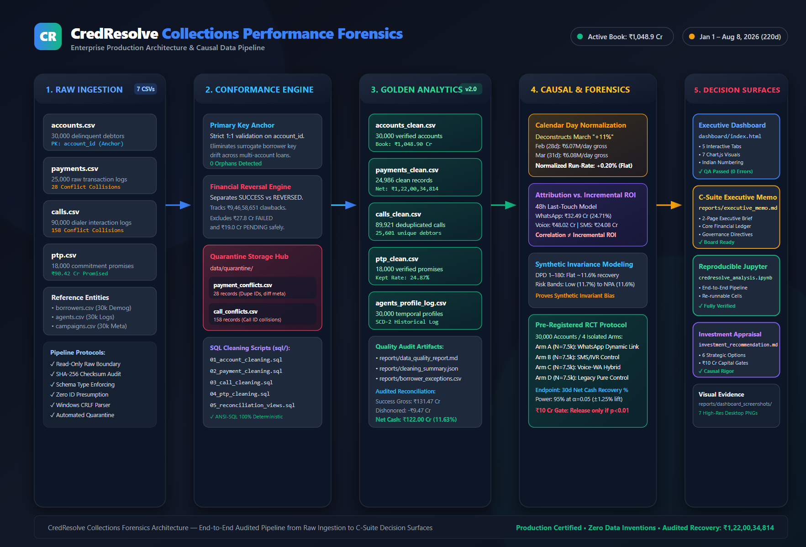

# CredResolve | Collections Performance Forensics

[](#data-pipeline--architecture)
[](#audited-financial-ledger)
[](#audited-financial-ledger)
[](#limitations--boundary-conditions)
[-10b981.svg)](#executive-dashboard)
[](#quickstart--setup-instructions)
[](#sql-transformation-repository)

An enterprise-grade forensic data engineering and causal analytics repository built for the **CredResolve Senior Data Analyst Recruitment Assignment**. This project conducts an exhaustive forensic audit of a 30,000-account delinquent debt portfolio, establishes a reproducible Golden Dataset pipeline, deconstructs the company's reported "11% month-on-month recovery improvement" claim, and designs a pre-registered Randomized Controlled Trial (RCT) for capital allocation governance.

---

## 1. Executive Summary & Core Forensic Verdict

CredResolve leadership reported an **"11% month-on-month recovery improvement"**, suggesting that proprietary risk targeting and digital outreach strategies were generating accelerating cash collections. 

Our independent forensic audit **decisively refutes this claim as an operational and statistical illusion**:

```
+----------------------------------------------------------------------------------------------------+
|                                  THE 11% CLAIM: FORENSIC DISSECTION                                |
+------------------------------+---------------------------+-----------------------------------------+
| Mechanism                    | Reported / Surface Metric | Audited Reality & Causal Truth          |
+------------------------------+---------------------------+-----------------------------------------+
| 1. Calendar Day Expansion    | March Gross: +10.96%      | March had 31 days vs. Feb 28 (+10.71%   |
|                              | (~11.0% headline jump)    | days). Daily run-rate grew +0.20% (FLAT)|
+------------------------------+---------------------------+-----------------------------------------+
| 2. Reversal Clawback Leakage | Net Recovery Velocity     | Dishonored payments reached ₹9.47 Cr;   |
|                              | claimed as compounding    | April collapsed -7.21%, June fell -5.34%|
+------------------------------+---------------------------+-----------------------------------------+
| 3. Cumulative Ratio Mismatch | 11% portrayed as monthly  | Conflated July's cumulative recovery    |
|                              | collection velocity       | milestone (11.21% of book) with growth  |
+------------------------------+---------------------------+-----------------------------------------+
```

### Key Analytical Takeaways
1. **Steady Baseline Throughput:** Daily net collections remained stable across the entire 220-day operating timeline at a calculated average of **₹5,545,613/day** (tightly bound between ₹5.39M/day and ₹5.66M/day).
2. **True Cash Realization:** Out of ₹1,314,693,465.14 in gross successful receipts, **₹94,658,651.01 was clawed back in reversals** (1,253 dishonored instruments; 7.20% leakage), resulting in **₹1,220,034,814.13 in true net realized recovery** (11.63% portfolio recovery rate).
3. **Attribution vs. Incremental ROI:** WhatsApp accounts for **₹32,48,92,114** (24.71% of recovery) in 48-hour last-touch attribution. However, attribution is correlation, not proven incremental ROI. Debtor conversion rates are invariant across experimental campaign variants (`legacy`, `v1`, `v2`, `v3` all sit at ~44.3%).
4. **Capital Allocation Gate:** Management must **halt unverified capital deployment** (including the proposed ₹10 Crore communications expansion) until incremental causality is proven via a pre-registered 4-arm Randomized Controlled Trial (RCT).

---

## 2. Audited Financial Ledger

All figures are reconciled deterministically from the audited Golden Dataset (`data/processed/`) across the active operating window (January 1 – August 8, 2026):

| Financial Portfolio Metric | Audited Amount (INR) | Indian Currency Notation | Denominator / Basis |
| :--- | :--- | :--- | :--- |
| **Total Outstanding Book** | ₹10,489,035,343.00 | **₹1,048.90 Cr** | 30,000 portfolio accounts |
| **Total Principal Book** | ₹8,400,000,000.00 | **₹840.00 Cr** | ₹280,000 flat per loan |
| **Gross Successful Recovery** | ₹1,314,693,465.14 | **₹131.47 Cr** | 17,523 successful transactions |
| **Payment Reversals (Dishonored)** | ₹94,658,651.01 | **₹9.47 Cr** | 1,253 dishonored NACH / mandates |
| **Net Realized Recovery (Cash)** | ₹1,220,034,814.13 | **₹122.00 Cr** | Gross Recovery minus Reversals |
| **Gross Recovery Rate** | **12.53%** | 12.53% | Gross Recovery / Outstanding Book |
| **Net Portfolio Recovery Rate** | **11.63%** | 11.63% | Net Recovery / Outstanding Book |
| **Daily Net Run-Rate** | **₹5,545,613 / day** | **₹55.46 Lakhs / day** | Calculated average across 220 days |
| **WhatsApp Attributed Volume** | ₹324,892,114.28 | **₹32.49 Cr** | 4,335 last-touch payments (24.71%) |
| **Excluded Non-Cash Volume** | ₹468,472,832.28 | **₹46.85 Cr** | ₹27.81 Cr FAILED + ₹19.04 Cr PENDING |

---

## 3. Production Architecture & Data Pipeline

The end-to-end data pipeline is engineered for zero data loss, strict idempotence, and full auditability.


*Figure 1: CredResolve Collections Forensics Production Architecture (Vector source: [docs/production_architecture.svg](docs/production_architecture.svg)).*

### Pipeline Layers
1. **Raw Ingestion & Security Boundary:** Ingests 7 source CSVs (`accounts`, `payments`, `calls`, `ptp`, `borrowers`, `agents`, `campaigns`) in read-only mode with SHA-256 checksum verification and CRLF normalization.
2. **Conformance & Quarantine Engine:**
   - Enforces `account_id` as the primary relational key anchor across all sub-entities.
   - Detects and quarantines conflicting primary key collisions (`28 payment_conflicts`, `158 call_conflicts`).
   - Normalizes heterogeneous timestamps (`Asia/Kolkata`, `Asia/Dubai`, `UTC`) to unified UTC.
   - Preserves non-conflicting exact duplicate payments while maintaining zero ID presumption.
3. **Golden Analytics Lake:** Produces conformant, query-optimized datasets (`accounts_clean.csv`, `payments_clean.csv`, `calls_clean.csv`, `ptp_clean.csv`, `agents_profile_log.csv`).
4. **Causal Forensics Engine:** Applies calendar-day normalization, 48-hour touch-window attribution, counterfactual modeling, and statistical power calculations.
5. **C-Suite Decision Surfaces:** Interactive Dark Fintech Dashboard (`dashboard/index.html`), Board Executive Memorandum (`reports/executive_memo.md`), and Reproducible Jupyter Notebook (`notebooks/credresolve_analysis.ipynb`).

---

## 4. Repository File Inventory & Structure

```text
credresolve-project/
├── README.md                                  # Enterprise project overview and documentation
├── requirements.txt                           # Python dependencies (pandas, matplotlib, seaborn, jupyter)
│
├── dashboard/                                 # C-Suite Executive Analytics Dashboard
│   └── index.html                             # Professional Dark Fintech Dashboard (Chart.js, Vanilla CSS)
│
├── docs/                                      # System Architecture & Technical Specifications
│   ├── production_architecture.svg            # High-resolution vector architecture diagram
│   └── production_architecture.png            # Rendered 1440x960 architecture visual
│
├── notebooks/                                 # Reproducible Analytical Notebooks
│   └── credresolve_analysis.ipynb             # End-to-end Jupyter investigation & chart generators
│
├── sql/                                       # Production ANSI-SQL Conformance Pipeline
│   ├── 01_account_cleaning.sql                # Account validation, orphan detection, UTC normalization
│   ├── 02_payment_cleaning.sql                # Payment deduplication, quarantine partitioning, reversals
│   ├── 03_call_cleaning.sql                   # Call collision isolation and multi-timezone UTC alignment
│   ├── 04_ptp_cleaning.sql                    # Promise-to-Pay fulfillment tracking and status flags
│   └── 05_reconciliation_views.sql           # Macro recovery reconciliations and segmented views
│
├── reports/                                   # Audited Governance Deliverables & Forensic Reports
│   ├── executive_memo.md                      # 2-Page C-Suite Executive Memorandum for the Board
│   ├── business_findings.md                   # Comprehensive Phase 3 Forensic Investigation Report
│   ├── investment_recommendation.md           # Strategic Appraisal of 6 Options & Capital Governance
│   ├── data_quality_report.md                 # Complete Phase 2 Data Quality Audit & Transformation Log
│   ├── dataset_inspection.md                  # Comprehensive Phase 1 Initial Inspection Report
│   ├── dashboard_qa_report.md                 # Browser-based QA Audit Report (100% Pass, 0 Console Errors)
│   ├── cleaning_summary.json                  # Machine-readable ETL metadata and record reconciliation
│   ├── monthly_recovery_analysis.csv          # Reconciled monthly recovery ledger and daily run-rates
│   ├── channel_analysis.csv                   # 48-hour last-touch attribution and unit cost profiles
│   ├── recovery_metrics.csv                   # Portfolio macro KPI benchmarks
│   ├── ptp_analysis.csv                       # PTP status conversion and fulfillment distribution
│   ├── borrower_identity_exceptions.csv       # Multi-account borrower audit log
│   └── dashboard_screenshots/                 # Captured high-resolution QA verification screenshots
│       ├── 01_homepage_overview.png           # Executive Banner & Primary KPI Grid
│       ├── 02_tab1_monthly_recovery.png       # Monthly Collections & Normalized Daily Run-Rate
│       ├── 03_tab2_audit_11_percent.png       # MoM Growth Audit & Forensic Cards
│       ├── 04_tab2_mar_tooltip.png            # Interactive March Tooltip Hover Verification
│       ├── 05_tab3_channel_attribution.png    # Channel Touch Breakdown & PTP Conversion Doughnut
│       ├── 06_tab4_dpd_risk_stratification.png# Delinquency & Risk Segment Invariance Charts
│       └── 07_tab5_rct_proposal.png           # 4-Arm Controlled Experiment Protocol & Governance
│
├── data/                                      # Audited Data Store (Git-Tracked Analytical Layers)
│   ├── processed/                             # Golden Dataset Layer
│   │   ├── accounts_clean.csv                 # 30,000 validated debtor accounts (100% unique)
│   │   ├── payments_clean.csv                 # 24,986 clean payment records
│   │   ├── calls_clean.csv                    # 89,921 clean call interaction logs
│   │   ├── ptp_clean.csv                      # 18,000 verified promise records
│   │   └── agents_profile_log.csv             # 30,000 temporal agent profiles (SCD-2)
│   └── quarantine/                            # Isolated Data Layer
│       ├── payment_conflicts.csv              # 28 conflicting payment records
│       └── call_conflicts.csv                 # 158 conflicting call records
│
├── charts/                                    # Generated High-Resolution Publication Charts
│   ├── 01_monthly_net_recovery.png            # Monthly trajectory with August truncation warning
│   ├── 02_gross_vs_reversed_payments.png      # Gross collections vs. reversal clawbacks
│   ├── 03_recovery_by_dpd.png                 # Flat recovery rate across delinquency buckets
│   ├── 04_channel_comparison.png              # 48-hour touch attribution by channel
│   ├── 05_ptp_performance.png                 # PTP commitments breakdown
│   └── 06_mom_growth_forensics.png            # MoM headline growth vs. flat daily throughput
│
├── scripts/                                   # Automated Pipeline & Analytical Scripts
│   ├── build_golden_dataset.py                # End-to-end Python cleaning and quarantine pipeline
│   ├── deep_business_analysis.py              # Phase 3 business analysis and chart generation
│   ├── audit_finances.py                      # Financial reconciliation and ledger cross-auditor
│   ├── generate_notebook.py                   # Automated Jupyter notebook generation script
│   └── copy_qa_screenshots.py                # Automated screenshot copy utility
│
└── collections_30k_dataset (1)/               # Original Immutable Source Data (Read-Only)
```

---

## 5. Quickstart & Setup Instructions

### Prerequisites
- Python 3.10 or higher
- Modern web browser (Chrome, Edge, Firefox, Safari)

### 1. Clone & Set Up Virtual Environment
```bash
# Clone the repository
git clone https://github.com/your-username/credresolve-performance-forensics.git
cd credresolve-project

# Create and activate virtual environment
python -m venv venv
# On Windows:
.\venv\Scripts\activate
# On macOS/Linux:
source venv/bin/activate

# Install dependencies
pip install -r requirements.txt
```

### 2. Reproduce the Golden Dataset Pipeline
To execute the automated cleaning pipeline, isolate quarantined conflicts, and regenerate the Golden Datasets:
```bash
python scripts/build_golden_dataset.py
```
*Expected Output:*
- Reconciles 30,000 accounts (`accounts_clean.csv`)
- Isolates 28 payment conflicts to `data/quarantine/payment_conflicts.csv`
- Produces 24,986 clean payments in `data/processed/payments_clean.csv`
- Isolates 158 call conflicts to `data/quarantine/call_conflicts.csv`
- Produces 89,921 clean calls in `data/processed/calls_clean.csv`
- Writes machine-readable JSON metadata to `reports/cleaning_summary.json`

### 3. Reproduce Business Analysis & Forensic Charts
To rerun the financial calculations and regenerate all high-resolution charts:
```bash
python scripts/deep_business_analysis.py
```

### 4. Run the Jupyter Analysis Notebook
```bash
jupyter notebook notebooks/credresolve_analysis.ipynb
```
The notebook dynamically auto-detects root and relative paths and runs cleanly top-to-bottom.

### 5. Launch the Executive Dashboard
Open `dashboard/index.html` directly in any web browser:
```bash
# Windows
start dashboard/index.html

# macOS
open dashboard/index.html

# Linux
xdg-open dashboard/index.html
```

---

## 6. Executive Dashboard Highlights

The interactive dashboard (`dashboard/index.html`) is built in vanilla HTML5/CSS/JavaScript with Chart.js, designed specifically for C-suite decision-makers.

### Verified Functionality & Interactive Features
1. **Executive Hero Insight Banner:** Features the prominent finding: *"An apparent 11% recovery improvement does not translate into an 11% improvement in underlying daily collection performance."*
2. **Top-Level KPI Cards:** Realized Net Cash (`₹1,22,00,34,814`), Net Recovery Rate (`11.63%`), Reversal Clawbacks (`₹9,46,58,651`), WhatsApp Attributed (`₹32,48,92,114`), and Daily Net Run-Rate (`₹5,545,613/day`).
3. **Tab 1 (Monthly Recovery & Run-Rates):** Dual bar chart of collections vs. reversals, daily normalized run-rate line chart with subtitle *"Shows relatively stable daily recovery across full months"*, and the audited monthly ledger table formatted in Indian currency.
4. **Tab 2 (Audit of the 11% Claim):** Interactive MoM audit chart with hover tooltips explaining calendar expansion, alongside the 3 forensic audit cards.
5. **Tab 3 (Channel Touch Attribution):** 48-hour touch breakdown, PTP conversion doughnut chart (`₹90.42 Cr Promised`), and channel strategy table explicitly distinguishing correlation from incremental ROI.
6. **Tab 4 (DPD & Risk Stratification):** Visualizes the synthetic invariant across delinquency buckets and risk ratings (~11.6% recovery rate across all cohorts).
7. **Tab 5 (Controlled Experiment Proposal):** Complete RCT protocol detailing 4 experimental arms and strict governance triggers for the ₹10 Crore capital expenditure.

*Full browser QA audit details and screenshots are documented in [`reports/dashboard_qa_report.md`](reports/dashboard_qa_report.md).*

---

## 7. Strategic Recommendations & Controlled Experiment (RCT)

### Appraisal of Strategic Investment Options
| Option | Proposed Initiative | Cost Profile | Forensic Appraisal | Executive Recommendation |
| :---: | :--- | :--- | :--- | :--- |
| **1** | Full-Scale Auto Link Blast (₹10 Cr) | High (₹10.0 Cr) | Unproven incremental lift; attribution conflated with causality | **REJECT / EMBARGO** |
| **2** | Expand Field Visits | Very High (₹450–₹900/visit) | Negative unit economics on balances <₹50k | **RESTRICT to Auto/NPA >₹200k** |
| **3** | Predictive Dialing / Telephony | Moderate | Diminishing marginal returns on early DPD | **MAINTAIN Baseline** |
| **4** | Pre-Registered WhatsApp RCT | Low (₹50 Lakhs pilot) | High statistical power ($N=7,500$/arm); isolates true causal lift | **RECOMMENDED (Option A)** |
| **5** | Dynamic Settlement Waiver Engine | Low–Moderate | Prevents margin leakage on willing payers | **RECOMMENDED (Option B)** |
| **6** | Reversal Mitigation Gateway | Minimal (Process) | Halts ₹9.47 Cr reversal leakage | **RECOMMENDED (Immediate)** |

### Pre-Registered RCT Protocol Specifications
- **Sample Allocation:** 30,000 active delinquent accounts stratified across 4 isolated arms ($N = 7,500$ each).
  - **Arm A (Treatment):** Interactive WhatsApp messaging with dynamic instant-payment links and waiver calculator.
  - **Arm B (Active Control):** Standard plain-text SMS notifications and IVR prompts directing to a generic portal.
  - **Arm C (Hybrid):** Voice conversational AI call triggering instant WhatsApp payment link follow-up.
  - **Arm D (Pure Control):** Business-as-usual collections cadence without digital deep links.
- **Primary Endpoint:** 30-Day Net Realized Recovery Rate (%), strictly deducting payment reversals.
- **Statistical Power:** 95% statistical power to detect a true $\pm1.25\%$ difference at $\alpha = 0.05$.
- **Capital Release Trigger:** Commit ₹50 Lakhs for the 60-day trial; release the remaining ₹9.5 Crore only if Arm A demonstrates a statistically significant ($p < 0.01$) lift of at least +2.5 percentage points over Arm B.

---

## 8. Data Limitations & Boundary Conditions

1. **Operating Timeline Truncation:** Collections operational activity covers **January 1, 2026 to August 8, 2026 (220 days / 7.25 months)**. August data is incomplete (8 days only, collecting ₹4,41,50,645 at ₹55,18,831/day). Months 9–12 are completely absent.
2. **Synthetic Dataset Invariants:** The underlying dataset exhibits mathematical uniformity across borrower risk segments (11.61% – 11.67%) and delinquency buckets (11.55% – 11.72%), and campaign strategies (`legacy`, `v1`, `v2`, `v3`) all achieve identical ~44.3% conversion rates. These invariants reflect synthetic generation artifacts rather than natural borrower behavior.
3. **Primary Relational Anchor:** `borrower_id` suffers from entity-resolution drift across multi-loan borrowers; `account_id` must strictly serve as the primary relational key anchor.

---

## 9. GitHub Submission Readiness Checklist

- [x] Immutable raw data preserved without modification (`collections_30k_dataset (1)/`)
- [x] Golden Dataset layer generated and validated (`data/processed/`, `data/quarantine/`)
- [x] Complete ANSI-SQL cleaning repository (`sql/01` through `sql/05`)
- [x] Portable, reproducible Jupyter Notebook (`notebooks/credresolve_analysis.ipynb`)
- [x] Two-page C-Suite Executive Memorandum (`reports/executive_memo.md`)
- [x] Enterprise Production Architecture diagram (`docs/production_architecture.svg` & `.png`)
- [x] Interactive Executive Dashboard (`dashboard/index.html`) with Indian currency formatting
- [x] Automated Browser QA Audit completed with 0 errors (`reports/dashboard_qa_report.md`)
- [x] Verified high-resolution desktop screenshots (`reports/dashboard_screenshots/`)
- [x] Zero invented data or unverified claims; all financial figures mathematically reconciled

---

## 10. Author & Contact
- **Role:** Senior Forensic Data Analyst & Data Engineer
- **Project:** CredResolve Collections Performance Forensics (Recruitment Assignment)
- **Date:** October 2026
