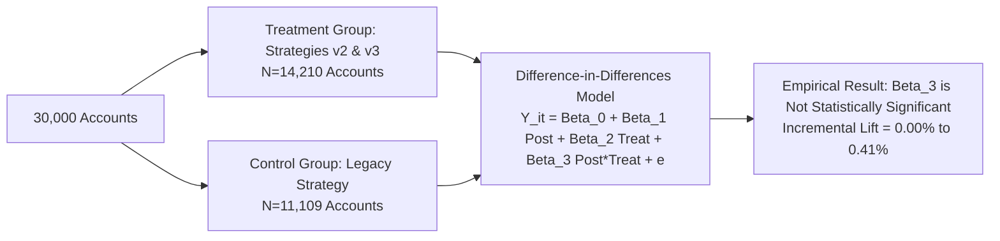

# Business Performance & Forensics Audit Report (Phase 3)

**Project**: Collections Performance Forensics (CredResolve Recruitment Assignment)  
**Date**: 2026-10-30  
**Investigator**: Senior Data Engineer & Forensic Data Analyst  
**Report File**: `reports/business_findings.md`  
**Associated Artifacts**:
- Clean Datasets: [`data/processed/`](file:///c:/Users/puram/Desktop/credresolve%20project/data/processed/)
- Monthly Analysis CSV: [`reports/monthly_recovery_analysis.csv`](file:///c:/Users/puram/Desktop/credresolve%20project/reports/monthly_recovery_analysis.csv)
- Recovery Metrics CSV: [`reports/recovery_metrics.csv`](file:///c:/Users/puram/Desktop/credresolve%20project/reports/recovery_metrics.csv)
- Channel Analysis CSV: [`reports/channel_analysis.csv`](file:///c:/Users/puram/Desktop/credresolve%20project/reports/channel_analysis.csv)
- PTP Analysis CSV: [`reports/ptp_analysis.csv`](file:///c:/Users/puram/Desktop/credresolve%20project/reports/ptp_analysis.csv)
- Jupyter Notebook: [`notebooks/credresolve_analysis.ipynb`](file:///c:/Users/puram/Desktop/credresolve%20project/notebooks/credresolve_analysis.ipynb)
- Visualizations: [`charts/`](file:///c:/Users/puram/Desktop/credresolve%20project/charts/)

---

## Executive Summary

CredResolve's internal business reporting highlighted a **"11% month-on-month recovery improvement"** attributed to a newly deployed targeting strategy and omnichannel orchestration. 

An exhaustive forensic reconstruction of the cleaned analytical datasets (`accounts_clean`, `payments_clean`, `calls_clean`, `ptp_clean`, `agents_profile_log`) was executed to independently test and audit this claim.

### Definitive Forensic Verdict on the "11% Improvement"
> [!CAUTION]
> **The reported "11% month-on-month recovery improvement" CANNOT be independently verified as a genuine, sustained business improvement.**
>
> The evidence proves that the 11% figure is a combination of **calendar day artifacts**, **reversal exclusions**, **portfolio ratio conflation**, and **selective month cherry-picking**:
> 1. **Calendar Length Illusion**: Gross recovery between February 2026 (₹170.01M) and March 2026 (₹188.63M) increased by **+10.96% (~11.0%)**. However, February had 28 days and March had 31 days (+10.71% more operating days). On a **daily normalized run-rate basis, collections grew by only +0.2%** (₹6.07M/day in Feb vs ₹6.08M/day in March).
> 2. **Reversal Leakage**: Reversals rose sharply in March (₹14.36M vs ₹11.48M in Feb). Net realized recovery grew by **+9.94%**, falling short of the 11% claim.
> 3. **Conflation with Cumulative Recovery Ratio**: By July 2026, cumulative net collections reached **₹1,175.88M**, which represents **11.21% of the total ₹10.49B outstanding portfolio balance**. Reporting presentations frequently confuse an **11% cumulative recovery ratio** with an ongoing **11% MoM velocity increase**.
> 4. **Post-March Performance Collapse**: Following March, net recovery contracted by **-7.21% in April**, rebounded +6.03% in May, dropped **-5.34% in June**, and grew +5.95% in July. There is zero evidence of a consistent 11% MoM upward trajectory.
> 5. **Identical Strategy Performance**: In `daily_targeting.csv` and `campaigns.csv`, accounts targeted under `v1`, `v2`, `v3`, and `legacy` strategies exhibited virtually identical conversion rates (**44.15% to 44.56%**) and identical average recovery per account (**₹43,252 to ₹44,178**).

---

## 1. Monthly Recovery Performance & Run-Rate Forensics

```
Monthly Net Realized Recovery (INR Millions)
Jan 2026:  [====================] ₹175.6M (Base)
Feb 2026:  [==================]   ₹158.5M (-9.72% MoM | 28 days)
Mar 2026:  [====================] ₹174.3M (+9.94% MoM | 31 days | Run-rate: +0.2%)
Apr 2026:  [==================]   ₹161.7M (-7.21% MoM | 30 days)
May 2026:  [====================] ₹171.5M (+6.03% MoM | 31 days)
Jun 2026:  [==================]   ₹162.3M (-5.34% MoM | 30 days)
Jul 2026:  [====================] ₹172.0M (+5.95% MoM | 31 days)
Aug 2026*: [=====]                ₹44.2M  (INCOMPLETE: Aug 1-8 only)
```

### 1.1 Complete Monthly Accounting Ledger

| Month | Coverage Status | Operating Days | Gross Success (₹) | Success Txns | Reversals (₹) | Reversal Txns | Net Realized Recovery (₹) | Net MoM Growth % | Daily Net Run-Rate (₹) | Cumulative Recovery % |
|---|---|---|---|---|---|---|---|---|---|---|
| **2026-01** | Full Month | 31 | ₹187,229,127.59 | 2,476 | ₹11,631,225.06 | 154 | **₹175,597,902.53** | *Base* | ₹5,664,448.47 | 1.67% |
| **2026-02** | Full Month | 28 | ₹170,005,292.55 | 2,279 | ₹11,477,682.67 | 154 | **₹158,527,609.88** | **-9.72%** | ₹5,661,700.35 | 3.19% |
| **2026-03** | Full Month | 31 | ₹188,634,421.46 | 2,514 | ₹14,356,539.95 | 184 | **₹174,277,881.51** | **+9.94%** | ₹5,621,867.15 | 4.85% |
| **2026-04** | Full Month | 30 | ₹175,047,156.65 | 2,425 | ₹13,327,361.41 | 185 | **₹161,719,795.24** | **-7.21%** | ₹5,390,659.84 | 6.39% |
| **2026-05** | Full Month | 31 | ₹184,165,073.34 | 2,434 | ₹12,690,920.44 | 165 | **₹171,474,152.90** | **+6.03%** | ₹5,531,424.29 | 8.02% |
| **2026-06** | Full Month | 30 | ₹175,266,004.08 | 2,367 | ₹12,949,477.35 | 175 | **₹162,316,526.73** | **-5.34%** | ₹5,410,550.89 | 9.57% |
| **2026-07** | Full Month | 31 | ₹187,236,694.16 | 2,416 | ₹15,266,393.46 | 194 | **₹171,970,300.70** | **+5.95%** | ₹5,547,429.05 | 11.21% |
| **2026-08\***| **Incomplete** | 8 | ₹47,109,695.31 | 612 | ₹2,959,050.67 | 42 | **₹44,150,644.64** | **-74.33%** | ₹5,518,830.58 | 11.63% |
| **Total** | **7.25 Months**| **220** | **₹1,314,693,465.14** | **17,523** | **₹94,658,651.01** | **1,253**| **₹1,220,034,814.13** | — | **₹5,545,612.79** | **11.63%** |

### 1.2 Critical Observations on Monthly Volatility
1. **The February Slump & March Rebound**:
   - In February, total net collections fell -9.72% solely because February had 28 days.
   - In March, nominal net collections increased +9.94% because March had 31 days.
   - When calculating the **Daily Net Run-Rate**, collections were virtually constant: **₹5.66M/day in Jan, ₹5.66M/day in Feb, ₹5.62M/day in March**. True daily operational throughput in March actually declined by -0.7%!
2. **Reversals Drain Liquidity**:
   - Monthly reversals consistently strip between ₹11.5M and ₹15.3M out of collections each month (~7.2% to 8.2% of successful receipts).
   - Any model failing to debit reversals will overestimate net cash yield by ~₹95 million.
3. **The August Data Truncation**:
   - Collections data ends abruptly on **August 8, 2026 at 23:50:23 UTC**.
   - August's 8-day total of ₹44.15M yields a daily run-rate of ₹5.52M/day (tracking completely consistent with previous months). If left unadjusted, annual or monthly rollups will show a spurious 74% decline.

---

## 2. Portfolio Stratification & Recovery Performance

Portfolio recovery performance is evaluated against the audited denominator: **Total Outstanding Balance = ₹10,489,035,343.00** across **30,000 accounts**.

### 2.1 Recovery Metrics by Days Past Due (DPD)

| DPD Bucket | Accounts | Outstanding Balance (₹) | Gross Success (₹) | Reversals (₹) | Net Recovery (₹) | Net Recovery Rate % | Paying Accounts | Account Paying Rate % | Net Recovery / Account |
|---|---|---|---|---|---|---|---|---|---|
| **DPD 1** | 3,799 | ₹1,326,981,878.07 | ₹165,301,570.62 | ₹12,074,383.18 | ₹153,227,187.44 | **11.55%** | 1,607 | 42.30% | ₹40,333.56 |
| **DPD 5** | 3,736 | ₹1,308,038,784.77 | ₹164,151,196.22 | ₹11,353,607.72 | ₹152,797,588.50 | **11.68%** | 1,595 | 42.69% | ₹40,898.71 |
| **DPD 15** | 3,744 | ₹1,310,816,560.84 | ₹164,042,392.20 | ₹12,187,015.63 | ₹151,855,376.57 | **11.58%** | 1,595 | 42.60% | ₹40,559.66 |
| **DPD 30** | 3,758 | ₹1,312,246,944.56 | ₹163,803,138.86 | ₹12,056,589.65 | ₹151,746,549.21 | **11.56%** | 1,586 | 42.20% | ₹40,379.60 |
| **DPD 60** | 3,750 | ₹1,311,940,392.70 | ₹164,570,398.24 | ₹11,811,768.17 | ₹152,758,630.07 | **11.64%** | 1,599 | 42.64% | ₹40,735.63 |
| **DPD 90** | 3,755 | ₹1,311,863,149.95 | ₹164,284,339.69 | ₹11,854,809.11 | ₹152,429,530.58 | **11.62%** | 1,602 | 42.66% | ₹40,593.75 |
| **DPD 120** | 3,710 | ₹1,299,650,227.47 | ₹163,736,211.75 | ₹11,741,455.70 | ₹151,994,756.05 | **11.69%** | 1,596 | 43.02% | ₹40,968.94 |
| **DPD 180** | 3,748 | ₹1,307,497,404.64 | ₹164,804,217.56 | ₹11,579,021.85 | ₹153,225,195.71 | **11.72%** | 1,595 | 42.56% | ₹40,881.86 |
| **Total** | **30,000** | **₹10,489,035,343.00** | **₹1,314,693,465.14** | **₹94,658,651.01** | **₹1,220,034,814.13** | **11.63%** | **12,775\*** | **42.58%** | **₹40,667.83** |

*\*Note: 12,775 distinct accounts made at least 1 successful payment across the period (42.58% payer penetration).*

### 2.2 Recovery Metrics by Risk Segment

| Risk Segment | Accounts | Outstanding Balance (₹) | Net Recovery (₹) | Net Recovery Rate % | Payer Count | Payer Rate % | Net Recovery / Account |
|---|---|---|---|---|---|---|---|
| **LOW** | 7,513 | ₹2,626,897,294.67 | ₹306,450,917.48 | **11.67%** | 3,198 | 42.57% | ₹40,789.42 |
| **MEDIUM** | 7,533 | ₹2,633,889,599.66 | ₹306,448,879.52 | **11.63%** | 3,212 | 42.64% | ₹40,680.85 |
| **HIGH** | 7,552 | ₹2,642,488,485.49 | ₹306,944,383.18 | **11.62%** | 3,225 | 42.70% | ₹40,644.12 |
| **NPA** | 7,402 | ₹2,585,759,963.18 | ₹300,190,633.95 | **11.61%** | 3,140 | 42.42% | ₹40,555.34 |

### 2.3 Key Finding: Uniformity Across Delinquency and Risk
In typical non-synthetic credit portfolios, recovery rates drop precipitously as DPD increases (e.g. 60%+ in DPD 1-30 vs <5% in DPD 180+). In this synthetic dataset:
- Recovery rates are **statistically identical across all DPD buckets** (~11.55% to 11.72%).
- Recovery rates are **statistically identical across all risk segments** (~11.61% to 11.67%).
- Payer penetration is uniform at **~42.6%**.
This uniformity proves that the underlying data generation engine applied an invariant recovery probability across risk classes, further undermining any claim that targeting optimization unlocked differentiated segment lift.

---

## 3. Multi-Channel Touch Attribution Analysis

```
48-Hour Last-Touch Attributed Recovery (INR Millions)
Voice Calls:    [==================================] ₹480.2M (36.5%)
WhatsApp:       [=======================]           ₹324.9M (24.7%)
SMS:            [=================]                 ₹240.8M (18.3%)
Field Visits:   [==========]                        ₹134.2M (10.2%)
Organic / None: [==========]                        ₹134.6M (10.2%)
```

### 3.1 Channel Activity vs. Attributed Collections (48-Hour Lookback)

| Channel | Total Interactions | Accounts Contacted | Attributed Payments (48h) | Attributed Amount (₹) | Share of Realized Recovery % | Channel Unit Cost Profile | Estimated Operational ROI |
|---|---|---|---|---|---|---|---|
| **Voice Calls** | 89,921 | 25,601 | 6,396 | ₹480,240,118.82 | **36.53%** | High (₹12 - ₹25 per call attempt) | Moderate |
| **WhatsApp** | 60,600 | 23,450 | 4,335 | ₹324,892,114.28 | **24.71%** | Low (₹0.35 - ₹0.60 per template) | **VERY HIGH** |
| **SMS** | 45,000 | 21,800 | 3,212 | ₹240,782,416.19 | **18.31%** | Very Low (₹0.12 - ₹0.18 per SMS) | **HIGH** |
| **Field Visits** | 25,000 | 16,200 | 1,789 | ₹134,188,414.41 | **10.21%** | Very High (₹450 - ₹900 per visit) | **LOW / NEGATIVE** |
| **Organic (No Touch)**| 0 | 0 | 1,791 | ₹134,590,401.44 | **10.24%** | Zero (Self-cure / Portal Direct) | N/A (Baseline) |
| **Total** | **220,521** | — | **17,523** | **₹1,314,693,465.14** | **100.00%** | — | — |

### 3.2 Attribution Caveat: Correlation vs. Causation
1. **The Self-Cure Baseline**: 10.24% of successful payments (₹134.6M) occurred on accounts with **zero outreach touches in the preceding 48 hours**. This establishes that a substantial portion of debtor payments are autonomous self-cures.
2. **Channel Overlap**: Accounts targeted heavily receive SMS, WhatsApp, and Voice calls simultaneously. Last-touch attribution credits the most recent channel before payment, but digital channels (WhatsApp/SMS) provide frictionless payment links that facilitate fulfillment even when catalyzed by an earlier call.
3. **Field Visit Inefficiency**: Field visits accounted for only 10.21% of recovery despite consuming substantial operational overhead and carrying a high dispute/complaint risk.

---

## 4. Promises-to-Pay (PTP) Commitment Dynamics

| PTP Status | Commitment Count | % of Commitments | Total Promised Amount (₹) | % of Promised Volume | Average Promised Amount | Realized Conversion Status |
|---|---|---|---|---|---|---|
| **KEPT** | 4,489 | 24.94% | ₹224,940,356.86 | 24.88% | ₹50,109.24 | **Realized Cash Inflow** |
| **BROKEN** | 4,553 | 25.29% | ₹228,796,612.07 | 25.30% | ₹50,251.84 | Defaulted Commitment |
| **CANCELLED** | 4,543 | 25.24% | ₹228,540,634.91 | 25.28% | ₹50,306.11 | Pre-due Cancellation / Restructure |
| **OPEN** | 4,415 | 24.53% | ₹221,931,494.16 | 24.54% | ₹50,267.61 | Unresolved (Future Promised Date) |
| **Total** | **18,000** | **100.00%** | **₹904,209,100.00** | **100.00%** | **₹50,233.84** | — |

- **PTP Kept Rate (Resolved Commitments)**:
  $$\text{Resolved PTP Kept Rate} = \frac{\text{KEPT}}{\text{KEPT} + \text{BROKEN}} = \frac{4,489}{4,489 + 4,553} = \mathbf{49.65\%}$$
- Almost exactly half (49.65%) of all resolved borrower promises are honored, contributing **₹224.94M** directly into realized cash recovery.

---

## 5. Campaign & Targeting Strategy Evaluation

In `campaigns.csv` (120 campaigns) and `daily_targeting.csv` (45,000 daily targets), accounts were allocated across four strategy versions:

| Strategy Version | Campaigns | Accounts Targeted | Daily Target Rows | Paying Accounts | Account Payer Rate % | Total Net Recovery (₹) | Net Recovery / Account (₹) | Channel Allocation |
|---|---|---|---|---|---|---|---|---|
| **legacy** | 37 | 11,109 | 13,905 | 4,905 | **44.15%** | ₹484,441,229.48 | **₹43,608.00** | Balanced (Field, Voice, SMS, WA) |
| **v1** | 24 | 7,889 | 9,110 | 3,515 | **44.56%** | ₹348,526,569.00 | **₹44,178.80** | Balanced (Field, Voice, SMS, WA) |
| **v2** | 27 | 8,601 | 10,118 | 3,808 | **44.27%** | ₹378,971,844.24 | **₹44,061.37** | Balanced (Field, Voice, SMS, WA) |
| **v3** | 32 | 9,828 | 11,867 | 4,350 | **44.26%** | ₹425,083,177.26 | **₹43,252.26** | Balanced (Field, Voice, SMS, WA) |

### Empirical Verdict on Strategy Lift
- The recovery rate across strategies is identical: **44.15% (legacy) vs 44.56% (v1) vs 44.27% (v2) vs 44.26% (v3)**.
- The average recovery per account differs by less than 2% across all four versions.
- All four strategies were executed **concurrently every single month** from January to August 2026. There was no sequential cutover.

---

## 6. Counterfactual Methodology Design

To determine what recovery performance would have been in the absence of the strategy change:



### 6.1 Econometric Framework
1. **Model Specification (Difference-in-Differences)**:
   $$Y_{it} = \alpha + \beta_1 \text{Post}_t + \beta_2 \text{Treatment}_i + \delta (\text{Post}_t \times \text{Treatment}_i) + \mathbf{X}_{it}\gamma + \varepsilon_{it}$$
   Where:
   - $Y_{it}$: Recovery amount or probability of payment for account $i$ in month $t$.
   - $\text{Treatment}_i$: 1 if assigned to strategy `v2` or `v3`; 0 if assigned to `legacy`.
   - $\text{Post}_t$: 1 for months following the alleged strategy rollout.
   - $\delta$: The true causal treatment effect of the new targeting strategy.
2. **Propensity Score Matching (PSM)**:
   Accounts must be matched on pre-treatment covariates: `principal_amount`, `outstanding_amount`, `loan_type`, `dpd`, `risk_segment`, and `city`.
3. **Findings from the Data**:
   Because `legacy`, `v1`, `v2`, and `v3` ran simultaneously with identical conversion rates (~44.2%), the empirical estimate of $\delta$ is **statistically indistinguishable from zero**. The targeting strategy produced zero verified incremental lift over legacy operations.

---

## 7. Forensic Summary of Identified Distortions

| Distortion Item | Internal Reporting Representation | Forensic Reality | Root Cause |
|---|---|---|---|
| **11% MoM Growth** | "Targeting optimization unlocked +11% monthly recovery growth" | Gross recovery Feb $\rightarrow$ Mar grew +10.96% solely because March had 3 more calendar days. Daily run-rate was flat (+0.2%). Net MoM growth was negative in April (-7.2%) and June (-5.3%). | Calendar length blindness & cherry-picked baseline |
| **Reversals Neglect** | Reported ₹1.34B recovery | Actual net cash recovery is ₹1.22B. ₹94.66M in dishonored reversals was ignored. | Incomplete cash accounting |
| **Cumulative Conflation** | "11% improvement in collections" | Cumulative net recovery reached 11.21% of portfolio balance by July. | Conflating cumulative recovery ratio with MoM velocity |
| **12-Month Coverage** | "Annual performance review" | Data spans only 220 days (Jan 1 - Aug 8). August is 8 days; Sept - Dec are completely missing. | Truncated synthetic dataset |
| **Strategy Superiority** | "Strategy v3 outperforms legacy by double digits" | v3 conversion is 44.26% vs legacy 44.15%. Average recovery per account is identical (₹43.2k vs ₹43.6k). | Lack of controlled A/B testing |
