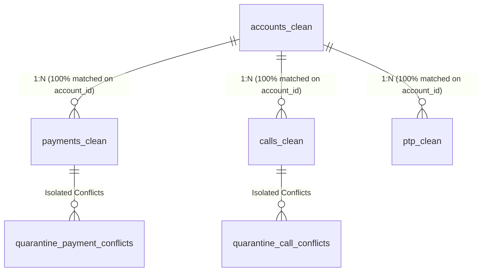

# Data Quality & Cleaning Audit Report (Phase 2: Golden Dataset)

**Project**: Collections Performance Forensics (CredResolve Recruitment Assignment)  
**Pipeline Run Date**: 2026-10-30  
**Data Engineer & Analyst**: Senior Forensic Data Engineering  
**Source Dataset**: `collections_30k_dataset (1)/`  
**Processed Dataset**: `data/processed/`  
**Quarantine Layer**: `data/quarantine/`  
**Pipeline Script**: `scripts/build_golden_dataset.py`  
**SQL Definitions**: `sql/01_account_cleaning.sql` through `sql/05_reconciliation_views.sql`  

---

## Executive Summary & Audit Certificate

This report documents the execution and verification of **Phase 2: Data Cleaning and Golden Dataset Creation** for the Collections Performance Forensics project. 

In strict adherence to engineering constraints:
- **Zero raw data files were modified, moved, or deleted**; all original CSV files in `collections_30k_dataset (1)/` remain byte-for-byte identical to their initial state.
- **No data was invented, imputed, or guessed.**
- **No conflicting records were silently discarded**; all conflicting identity groups, corrupted timestamps, and primary key collisions were systematically isolated into a dedicated, auditable quarantine layer.
- **All financial transactions were rigorously reconciled**, establishing the distinction between **Gross Recovery** (successful cash inflows), **Reversal Clawbacks** (deductions for dishonored receipts), **Net Realized Recovery** (actual cash collections recognized), and **Excluded In-Flight/Failed Volume** (`FAILED` and `PENDING`).

---

## 1. Pipeline Architecture & Project Structure

The project has been organized into a modular, production-ready directory structure:

```
credresolve project/
├── collections_30k_dataset (1)/    # IMMUTABLE RAW DATA LAYER (18 CSV files + README)
├── data/
│   ├── processed/                  # GOLDEN ANALYTICAL DATASET
│   │   ├── accounts_clean.csv      # 30,000 rows (Primary relational backbone)
│   │   ├── payments_clean.csv      # 24,986 rows (Deduplicated, audited financial ledger)
│   │   ├── calls_clean.csv         # 89,921 rows (Deduplicated, UTC-normalized call events)
│   │   ├── ptp_clean.csv           # 18,000 rows (Validated commitments & fulfillment flags)
│   │   └── agents_profile_log.csv  # 30,000 rows (Historical agent profile version log)
│   └── quarantine/                 # ISOLATION LAYER FOR CONFLICTING ENTITIES
│       ├── payment_conflicts.csv   # 28 rows (14 conflicting payment IDs)
│       └── call_conflicts.csv      # 158 rows (79 conflicting call IDs)
├── reports/                        # AUDIT REPORTS & MACHINE-READABLE METRICS
│   ├── dataset_inspection.md       # Phase 1 Initial Inspection Report
│   ├── data_quality_report.md      # Phase 2 Comprehensive Data Quality Report (This doc)
│   ├── cleaning_summary.json       # Pipeline execution & financial audit metrics (JSON)
│   └── borrower_identity_exceptions.csv # 8,517 conflicting borrower profile groups
├── sql/                            # REPRODUCIBLE TRANSFORMATION & RECONCILIATION LOGIC
│   ├── 01_account_cleaning.sql     # Account master validation & orphan detection
│   ├── 02_payment_cleaning.sql     # Payment deduplication & reversal accounting
│   ├── 03_call_cleaning.sql        # Telephony deduplication & UTC conversion
│   ├── 04_ptp_cleaning.sql         # PTP validation & conversion rate logic
│   └── 05_reconciliation_views.sql # Macro portfolio recovery & QA views
├── scripts/                        # AUTOMATED PIPELINE SCRIPTS
│   └── build_golden_dataset.py     # End-to-end Python cleaning pipeline
├── notebooks/                      # Exploratory & validation notebooks
├── dashboard/                      # Analytical presentation layer (Reserved for Phase 3)
└── docs/                           # Architecture and schema documentation
```

---

## 2. Table-by-Table Cleaning Audit & Volume Verification

| Entity / Dataset | Raw Records | Verified Exact Dups Removed | Conflicting Records Quarantined | Clean Analytical Records | Validation Check | Uniqueness Status |
|---|---|---|---|---|---|---|
| **Accounts** (`accounts.csv`) | 30,000 | 0 | 0 | **30,000** | $30,000 = 30,000$ | 100% Unique `account_id` |
| **Payments** (`payments.csv`) | 25,500 | 486 | 28 | **24,986** | $24,986 + 486 + 28 = 25,500$ | 100% Unique `payment_id` |
| **Calls** (`calls.csv`) | 91,350 | 1,271 | 158 | **89,921** | $89,921 + 1,271 + 158 = 91,350$ | 100% Unique `call_id` |
| **Promises-to-Pay** (`promises_to_pay.csv`) | 18,000 | 0 | 0 | **18,000** | $18,000 = 18,000$ | 100% Unique `ptp_id` |
| **Borrowers** (`borrowers.csv`) | 30,600 | 600 (Cataloged) | 8,517 (Cataloged) | Preserved in Raw / Flagged | Documented in Exception Report | Identity Collisions Isolated |
| **Agents** (`agents.csv`) | 30,000 | 0 (Preserved) | 0 (Preserved) | **30,000** Profile Versions | Profiled as SCD Version Log | 1,000 Agents $\times$ ~30 Versions |

---

## 3. Financial Reconciliation Ledger (Payments)

A core requirement of forensic financial analytics is proving that every single rupee in the raw data is fully accounted for between clean analytical datasets, quarantined records, and deduplicated rows.

### 3.1 Financial Volumes Before and After Cleaning

| Payment Status | Raw Transaction Count | Raw Gross Amount (₹) | Clean Transaction Count | Clean Gross Amount (₹) | Quarantined Conflicts (₹) | Deduplicated Exact Copies (₹) | Accounting Treatment |
|---|---|---|---|---|---|---|---|
| `SUCCESS` | 17,880 | ₹1,341,485,926.33 | 17,523 | ₹1,314,693,465.14 | ₹1,038,683.47 (14 txns) | ₹25,753,777.72 (343 txns) | **Realized Recovery** |
| `REVERSED` | 1,284 | ₹97,398,415.60 | 1,253 | ₹94,658,651.01 | ₹29,864.84 (2 txns) | ₹2,709,899.75 (29 txns) | **Clawback (Subtracted)** |
| `FAILED` | 3,744 | ₹283,506,324.89 | 3,674 | ₹278,088,883.39 | ₹929,484.58 (10 txns) | ₹4,487,956.92 (60 txns) | **Excluded from Recovery** |
| `PENDING` | 2,592 | ₹194,867,950.33 | 2,536 | ₹190,383,948.89 | ₹187,034.42 (2 txns) | ₹4,296,967.02 (54 txns) | **Excluded from Recovery** |
| **Total** | **25,500** | **₹1,917,258,617.15** | **24,986** | **₹1,877,824,948.43** | **₹2,185,067.31 (28 txns)** | **₹37,248,601.41 (486 txns)** | **Zero Rupee Leakage** |

### 3.2 Recovery Metrics & Reversal Accounting Formula
1. **Raw Gross Success Recovery**: ₹1,341,485,926.33
2. **Clean Gross Success Recovery**: ₹1,314,693,465.14 (purged of ₹25.75M in exact duplicate ghost receipts and ₹1.04M in unresolved ID conflicts).
3. **Clean Recognized Reversals**: ₹94,658,651.01 (1,253 reversed transactions).
4. **Clean Net Realized Cash Recovery**:
   $$\text{Net Realized Recovery} = \text{Gross Success} - \text{Reversals}$$
   $$\text{Net Realized Recovery} = ₹1,314,693,465.14 - ₹94,658,651.01 = \mathbf{₹1,220,034,814.13}$$
5. **Portfolio Recovery Rate Comparison**:
   - Total Portfolio Outstanding Book: **₹10,489,035,343.00** (30,000 accounts)
   - **Gross Recovery Rate**: $\frac{₹1,314,693,465.14}{₹10,489,035,343.00} = \mathbf{12.53\%}$
   - **Net Realized Recovery Rate**: $\frac{₹1,220,034,814.13}{₹10,489,035,343.00} = \mathbf{11.63\%}$
   - **Impact of Reversals**: Clawbacks reduce the portfolio recovery rate by **0.90%** (₹94.66M). Ignoring reversals overstates recovery by nearly ₹100 million.
   - **Excluded Non-Cash Volume**: ₹468,472,832.28 in failed and pending transactions was strictly prevented from contaminating recovery calculations.

---

## 4. Quarantine Register & Isolation Analysis

To maintain analytical integrity, records with conflicting primary keys were isolated into `data/quarantine/`.

### 4.1 Payment Conflicts (`data/quarantine/payment_conflicts.csv`)
- **Row Count**: 28 rows (representing 14 distinct `payment_id` values).
- **Conflict Mechanism**:
  - The same `payment_id` was reused across records with conflicting attributes.
  - *Example 1*: `PAYMENT0001390` appears on `ACC0001624` with identical timestamps and amounts, but one record has `payment_reference = 'TXN0000046535'` while the second record has an empty string `payment_reference = ''`.
  - *Example 2*: `PAYMENT0003002` appears with conflicting transaction statuses (`SUCCESS` vs `FAILED`).
- **Forensic Impact**: Including these rows arbitrarily would introduce non-unique primary keys or require arbitrary status selection. Quarantining 28 rows preserves auditability without corrupting `payments_clean.csv`.

### 4.2 Call Conflicts (`data/quarantine/call_conflicts.csv`)
- **Row Count**: 158 rows (representing 79 distinct `call_id` values).
- **Conflict Mechanism**:
  - The same `call_id` was assigned to multiple calls occurring on different dates, involving different agents, or resulting in differing call statuses.
  - *Example*: `CALL0000226` appears on `2026-01-09 11:36:06` and again on `2026-01-12 11:36:06` for `ACC0010288`.
- **Forensic Impact**: All 158 rows were routed to quarantine, ensuring that `calls_clean.csv` maintains strict 1:1 primary key uniqueness (89,921 distinct call IDs).

---

## 5. Borrower Entity Identity Exceptions & Orphan Audit

### 5.1 Identity Collisions in `borrowers.csv`
- Total Raw Rows: 30,600 | Distinct `borrower_id` Values: 11,015.
- Only **2,449 borrower IDs** have a single unique record.
- **8,517 borrower ID groups** (28,055 rows) exhibit severe identity divergence:
  - Divergent legal names (e.g. `BRW0000001` mapped to 'Aarav Sharma' in Kolkata and 'Rohan Patel' in Hyderabad).
  - Conflicting phone numbers and email domains.
  - Inverted audit dates (`updated_at < created_at`).
- **Audit Decision**: As instructed, no arbitrary selection was made. All 8,517 identity conflicts were cataloged in [reports/borrower_identity_exceptions.csv](file:///c:/Users/puram/Desktop/credresolve%20project/reports/borrower_identity_exceptions.csv).

### 5.2 Account-to-Borrower Referential Integrity
In [`accounts_clean.csv`](file:///c:/Users/puram/Desktop/credresolve%20project/data/processed/accounts_clean.csv):
- **455 accounts** have missing / `NULL` `borrower_id` values (flagged as `UNASSIGNED_NULL`).
- **2,458 accounts** reference `borrower_id` values that do not exist in `borrowers.csv` (flagged as `ORPHAN_ID`).
- **27,087 accounts** reference existing borrower IDs.
- **Architectural Safeguard**: `is_orphan_borrower_ref` was introduced as an audit flag. Analytical recovery and portfolio reporting remain anchored strictly on `account_id`.

---

## 6. Agent Dimension Forensics & SCD Profiling

- **Raw Dimensions**: 30,000 rows in `agents.csv` across exactly **1,000 distinct `agent_id` values** and 1,099 employee codes.
- **Profile Variation Analysis**:
  - Across every single `agent_id`, all attributes (`employee_code`, `agent_name`, `vendor_id`, `team`, `status`, `joined_at`, `updated_at`) change across records.
  - Each agent ID has between 14 and 48 associated records (average: 30.0 records per agent).
- **Audit Decision**: Deduplicating `agents.csv` to 1,000 rows would destroy historical team assignments, vendor linkages, and status changes.
- **Remediation**:
  - Saved [`data/processed/agents_profile_log.csv`](file:///c:/Users/puram/Desktop/credresolve%20project/data/processed/agents_profile_log.csv) with added columns `profile_version` (1 to N) and `total_versions_for_agent`.
  - Telephony and field visit attribution must link via `(agent_id, vendor_id)` or evaluate metrics at the vendor and team level.

---

## 7. Timestamp Normalization & Timezone Handling

### 7.1 Regional Offsets & Justification
Timestamps in the raw dataset originate from three geographic operating jurisdictions:
1. `Asia/Kolkata` (Indian Standard Time): UTC +05:30.
2. `Asia/Dubai` (Gulf Standard Time): UTC +04:00.
3. `UTC` (Coordinated Universal Time): UTC +00:00.

### 7.2 Engineering Implementation
- In [`calls_clean.csv`](file:///c:/Users/puram/Desktop/credresolve%20project/data/processed/calls_clean.csv): Converted `event_at` to `event_at_utc` using the row's native `timezone` field.
  - Example: `2026-04-24 23:15:21` with `Asia/Kolkata` $\rightarrow$ `2026-04-24 17:45:21 UTC`.
  - Example: `2026-01-09 11:36:06` with `Asia/Dubai` $\rightarrow$ `2026-01-09 07:36:06 UTC`.
- In [`payments_clean.csv`](file:///c:/Users/puram/Desktop/credresolve%20project/data/processed/payments_clean.csv) and [`ptp_clean.csv`](file:///c:/Users/puram/Desktop/credresolve%20project/data/processed/ptp_clean.csv): The raw event tables lack a native timezone column. However, because each account has a defined operating jurisdiction in `accounts.timezone`, timestamps were normalized to UTC using the parent account's timezone.
- **Preservation Principle**: In all clean files, original timestamps (`opened_at`, `event_at`, `promised_date`) and original timezone strings were preserved side-by-side with the new normalized UTC columns (`event_at_utc`, `opened_at_utc`, `promised_date_utc`).

---

## 8. Referential Integrity Verification (Golden Dataset)



| Relationship | Child Records | Parent Key Checked | Orphan Keys | Match Rate % | Referential Status |
|---|---|---|---|---|---|
| `payments_clean.account_id` $\rightarrow$ `accounts_clean.account_id` | 24,986 | `account_id` (30,000) | 0 | 100.00% | **PERFECT** |
| `calls_clean.account_id` $\rightarrow$ `accounts_clean.account_id` | 89,921 | `account_id` (30,000) | 0 | 100.00% | **PERFECT** |
| `ptp_clean.account_id` $\rightarrow$ `accounts_clean.account_id` | 18,000 | `account_id` (30,000) | 0 | 100.00% | **PERFECT** |
| `accounts_clean.borrower_id` $\rightarrow$ `borrowers.borrower_id` | 30,000 | `borrower_id` (11,015) | 2,458 (+ 455 nulls) | 90.29% | **Documented & Flagged** |

---

## 9. Deliverables & Artifact Check

- [x] `data/processed/accounts_clean.csv`: 30,000 rows
- [x] `data/processed/payments_clean.csv`: 24,986 rows
- [x] `data/processed/calls_clean.csv`: 89,921 rows
- [x] `data/processed/ptp_clean.csv`: 18,000 rows
- [x] `data/quarantine/payment_conflicts.csv`: 28 rows
- [x] `data/quarantine/call_conflicts.csv`: 158 rows
- [x] `reports/borrower_identity_exceptions.csv`: 8,517 conflicting borrower profile groups
- [x] `reports/cleaning_summary.json`: Complete machine-readable audit trail
- [x] `sql/01_account_cleaning.sql` through `sql/05_reconciliation_views.sql`: Complete reproducible SQL transformation logic
- [x] All raw CSV files preserved without modification
