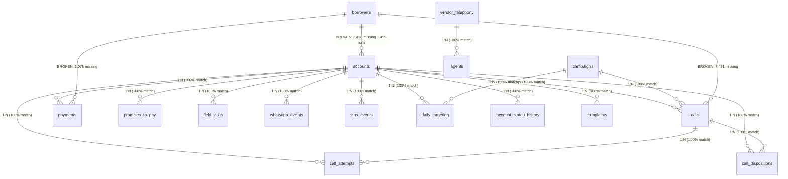
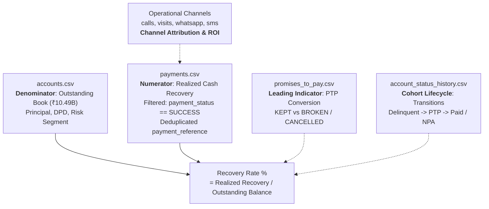

# Dataset Forensic Inspection Report: Collections Performance Forensics

**Project**: Collections Performance Forensics (CredResolve Data Analyst Recruitment Assignment)  
**Dataset Directory**: `collections_30k_dataset (1)/`  
**Inspection Date**: 2026-10-30  
**Inspector Role**: Senior Data Engineer & Data Analyst  
**Report File**: `reports/dataset_inspection.md`  

---

## Executive Summary

A comprehensive, non-destructive forensic inspection was executed across all 18 CSV files and supporting documentation (`README.md`, `data_dictionary.csv`) in `collections_30k_dataset (1)/`.

### Key Forensic Findings
1. **Scope & Scale**: The dataset contains **17 relational data tables** plus **1 data dictionary table**, totaling **554,185 data rows** and covering portfolio accounts, borrower profiles, agent staffing, telephony infrastructure, multi-channel outreach (calls, attempts, dispositions, SMS, WhatsApp, field visits), payment transactions, promises-to-pay (PTP), complaints, daily targeting, and account lifecycle history.
2. **The Claimed 12 Months vs. Actual Temporal Span**:
   - **The dataset does NOT cover 12 months of operational collections performance.**
   - All operational interaction and financial transaction tables (`calls`, `call_attempts`, `call_dispositions`, `field_visits`, `whatsapp_events`, `sms_events`, `payments`, `promises_to_pay`, `complaints`, `daily_targeting`, `account_status_history`, `agent_sessions`) strictly span **January 1, 2026 to August 8, 2026** (approx. **7.25 months**). Activity in August truncates sharply on August 8.
   - Historical static account origination dates (`accounts.opened_at`) span from January 2024 to November 2025 (23 months of static book origination), but active collections operations cover only ~220 days in 2026.
3. **Core Entity Anchor**:
   - `accounts.csv` (`account_id`) serves as the true referential backbone of the entire data model. Every single operational and event table links to `accounts.account_id` with **100% referential integrity (0 orphan keys, 0 missing foreign keys)**.
4. **Severe Entity-Identity Collisions**:
   - `borrowers.csv` contains **8,566 duplicate borrower IDs** across 30,600 rows (only 11,015 unique IDs), including 600 exact duplicate rows. Furthermore, 2,458 account records refer to borrower IDs that do not exist in `borrowers.csv`, and 455 accounts have `NULL` `borrower_id`.
   - `agents.csv` contains 30,000 rows but only **1,000 unique `agent_id` values** and 1,099 unique employee codes. Each `agent_id` is replicated ~30 times with conflicting employee codes, names, vendors, and teams.
5. **Injected Noise & Duplication**:
   - Injected duplicates occur in event tables: `calls.csv` (1,271 exact duplicate rows, 1,350 duplicate `call_id`s), `payments.csv` (486 exact duplicates, 500 duplicate `payment_id`s), and `whatsapp_events.csv` (600 exact duplicates).
   - In `payments.csv`, there are **3,746 duplicate `payment_reference` values** spanning across different accounts and transaction dates, requiring careful deduplication prior to calculating collections yield.
6. **Timezone Misalignment**:
   - Timestamps are captured across three distinct regional timezones (`UTC`, `Asia/Kolkata` [+05:30], `Asia/Dubai` [+04:00]) stored without standardized ISO offset strings in several operational tables. Normalization to a unified UTC baseline is mandatory before sequence analysis or attribution.

---

## 1. Inventory of Dataset Tables

The package contains 18 CSV files (17 relational tables + 1 metadata dictionary).

| # | Table / CSV Name | Category | Primary Key Candidate | Nominal Row Count | Column Count | Exact Dup Rows |
|---|------------------|----------|----------------------|-------------------|--------------|----------------|
| 1 | `accounts.csv` | Core Entity | `account_id` | 30,000 | 11 | 0 |
| 2 | `borrowers.csv` | Core Entity | `borrower_id` (Compromised) | 30,600 | 8 | 600 |
| 3 | `agents.csv` | Core Entity | `agent_id` (Compromised) | 30,000 | 8 | 0 |
| 4 | `vendor_telephony.csv` | Reference / Config | `vendor_id` | 15 | 6 | 0 |
| 5 | `agent_sessions.csv` | Operational Logging | `session_id` | 15,000 | 7 | 0 |
| 6 | `campaigns.csv` | Campaign Strategy | `campaign_id` | 120 | 7 | 0 |
| 7 | `daily_targeting.csv` | Operational Strategy | `target_id` | 45,000 | 7 | 0 |
| 8 | `calls.csv` | Telephony Interaction | `call_id` (Injected Dups) | 91,350 | 11 | 1,271 |
| 9 | `call_attempts.csv` | Telephony Interaction | `attempt_id` | 120,000 | 9 | 0 |
| 10 | `call_dispositions.csv`| Telephony Disposition | `disposition_id` | 35,000 | 8 | 0 |
| 11 | `whatsapp_events.csv` | Digital Outreach | `whatsapp_event_id` (Injected) | 60,600 | 8 | 600 |
| 12 | `sms_events.csv` | Digital Outreach | `sms_event_id` | 45,000 | 8 | 0 |
| 13 | `field_visits.csv` | Feet-on-Street Outreach | `visit_id` | 25,000 | 10 | 0 |
| 14 | `promises_to_pay.csv` | Borrower Commitments | `ptp_id` | 18,000 | 9 | 0 |
| 15 | `payments.csv` | Financial Transactions | `payment_id` (Injected Dups) | 25,500 | 9 | 486 |
| 16 | `complaints.csv` | Regulatory / Risk | `complaint_id` | 8,000 | 9 | 0 |
| 17 | `account_status_history.csv` | Portfolio State History | `history_id` | 60,000 | 8 | 0 |
| 18 | `data_dictionary.csv` | Metadata Documentation | Composite (`dataset`, `column`) | 143 | 3 | 0 |
| **Total** | | | | **554,328** | | **2,957** |

---

## 2. Table-by-Table Schema, Keys & Quality Profiling

### 2.1 `accounts.csv`
- **Role**: Portfolio master table containing loan balance, delinquency, and segment definitions.
- **Row Count**: 30,000 | **Column Count**: 11
- **Primary Key Candidate**: `account_id` (30,000 unique, 0 nulls, 0 duplicates — **100% Unique & Valid PK**).
- **Columns & Missingness**:
  - `account_id`: 0 nulls (0.00%)
  - `borrower_id`: **455 nulls (1.52%)** — Orphan or unassigned borrower profiles.
  - `loan_type`: 0 nulls (Values: `AUTO`, `BNPL`, `CREDIT_CARD`, `PERSONAL`, `CONSUMER`).
  - `principal_amount`: 0 nulls (Range: ₹10,001.32 to ₹1,199,997.52; Total Principal: ₹12,103,665,653.54).
  - `outstanding_amount`: 0 nulls (Range: ₹5,002.11 to ₹1,148,892.40; Total Outstanding: ₹10,489,035,343.00).
  - `dpd` (Days Past Due): 0 nulls (Values: 1, 5, 15, 30, 60, 90, 120, 180).
  - `risk_segment`: 0 nulls (Values: `LOW`: 7,513; `MEDIUM`: 7,533; `HIGH`: 7,552; `NPA`: 7,402).
  - `status`: 0 nulls (Values: `ACTIVE`: 7,539; `PAID`: 7,486; `CLOSED`: 7,496; `WRITEOFF`: 7,479).
  - `opened_at`: 0 nulls (Date range: `2024-01-01 00:02:27` to `2025-11-30 23:52:36`).
  - `timezone`: 0 nulls (Values: `Asia/Dubai`: 9,923; `Asia/Kolkata`: 9,981; `UTC`: 10,096).
  - `schema_version`: 0 nulls (Values: `v1`: 10,152; `v2`: 10,026; `v3`: 9,822).

### 2.2 `borrowers.csv`
- **Role**: Master borrower identity and contact records.
- **Row Count**: 30,600 | **Column Count**: 8
- **Primary Key Candidate**: `borrower_id` (**FAILED PK Test**: only 11,015 distinct IDs; **8,566 duplicate ID occurrences**; 600 exact duplicate rows).
- **Columns & Missingness**:
  - `borrower_id`: 0 nulls.
  - `name`: 0 nulls.
  - `phone`: **614 nulls (2.01%)**.
  - `email`: **895 nulls (2.92%)**.
  - `city`: 0 nulls (Major Indian metros: Mumbai, Delhi, Bengaluru, Chennai, Hyderabad, Kolkata, Pune, Jaipur, etc.).
  - `created_at`: 0 nulls (Range: `2025-01-01 00:14:38` to `2026-08-03 23:37:55`).
  - `updated_at`: 0 nulls (Range: `2025-01-01 00:19:40` to `2026-08-03 23:48:36`).
  - `state`: 0 nulls.
- **Forensic Anomaly**: Identity collision. For example, `BRW0000001` appears under multiple different individual names ('Aarav Sharma' in Kolkata vs 'Rohan Patel' in Hyderabad) with conflicting contact details. Furthermore, several rows exhibit `updated_at < created_at`.

### 2.3 `agents.csv`
- **Role**: Telephony and field agent personnel records.
- **Row Count**: 30,000 | **Column Count**: 8
- **Primary Key Candidate**: `agent_id` (**FAILED PK Test**: only **1,000 unique `agent_id` values** across 30,000 rows; 0 exact duplicate rows).
- **Columns & Missingness**:
  - `agent_id`: 0 nulls (Values: `AGT0000001` to `AGT0001000`).
  - `employee_code`: 0 nulls (1,099 unique values; each employee code repeats ~27 times).
  - `agent_name`: 0 nulls.
  - `vendor_id`: 0 nulls (All map cleanly to `vendor_telephony.vendor_id`).
  - `team`: 0 nulls (Values: `T1`, `T2`, `T3`, `DIGITAL`, `FIELD`).
  - `status`: 0 nulls (Values: `ACTIVE`, `INACTIVE`, `SUSPENDED`).
  - `joined_at`: 0 nulls (Range: `2024-01-01 01:08:44` to `2026-06-25 15:35:12`).
  - `updated_at`: 0 nulls (Range: `2024-01-14 06:17:15` to `2026-08-08 19:35:36`).
- **Forensic Anomaly**: Multiple Agent Identifiers & Inconsistent Mapping. A single `agent_id` (e.g. `AGT0000001`) maps to multiple distinct human names, vendor IDs, and employee codes across different records. This represents a historical SCD (Slowly Changing Dimension) or tracking table that was flattened without an explicit version or effective date key.

### 2.4 `vendor_telephony.csv`
- **Role**: Telephony and gateway vendor master table.
- **Row Count**: 15 | **Column Count**: 6
- **Primary Key Candidate**: `vendor_id` (15 unique, 0 nulls, 0 dups — **100% Unique & Valid PK**).
- **Columns**: `vendor_id`, `vendor_name` (`Airtel`, `Exotel`, `Twilio`, `Knowlarity`, `TataTele`), `vendor_account_id`, `timezone` (`UTC`, `Asia/Kolkata`), `status` (`ACTIVE`, `INACTIVE`), `schema_version` (`v1`, `v2`, `v3`).

### 2.5 `agent_sessions.csv`
- **Role**: Agent login/logout tracking.
- **Row Count**: 15,000 | **Column Count**: 7
- **Primary Key Candidate**: `session_id` (15,000 unique, 0 nulls, 0 dups — **Valid PK**).
- **Foreign Keys**: `agent_id` (Clean match to `agents.agent_id`).
- **Date Ranges**:
  - `login_at`: `2026-01-01 00:01:57` to `2026-08-08 23:51:54` (15,000 records).
  - `logout_at`: `2026-01-01 04:48:48` to `2026-08-09 07:50:12` (15,000 records).
- **Channels**: `VOICE`, `WHATSAPP`, `SMS`, `FIELD`.
- **Timezones**: `UTC`, `Asia/Kolkata`.

### 2.6 `campaigns.csv`
- **Role**: Collections campaign strategies and segment definitions.
- **Row Count**: 120 | **Column Count**: 7
- **Primary Key Candidate**: `campaign_id` (120 unique, 0 nulls, 0 dups — **Valid PK**).
- **Date Ranges**:
  - `start_at`: `2026-01-01 09:34:51` to `2026-05-29 20:31:27`.
  - `end_at`: `2026-01-16 12:12:50` to `2026-08-16 18:13:39`.
- **Strategy Versions**: `legacy` (37), `v1` (24), `v2` (27), `v3` (32).
- **Channels**: `FIELD` (18), `MIXED` (23), `VOICE` (20), `WHATSAPP` (31), `SMS` (28).
- **Target Definitions**: `DPD>=30`, `DPD>=60`, `HIGH_RISK`, `NPA`, `PROMISE_BROKEN`.

### 2.7 `daily_targeting.csv`
- **Role**: Daily account allocation to campaigns and recommended outreach channels.
- **Row Count**: 45,000 | **Column Count**: 7
- **Primary Key Candidate**: `target_id` (45,000 unique, 0 nulls, 0 dups — **Valid PK**).
- **Foreign Keys**: `account_id` (100% matched to `accounts`), `campaign_id` (100% matched to `campaigns`).
- **Date Range**: `target_date`: `2026-01-01` to `2026-08-08` (0 nulls).
- **Status Distribution**: `CONTACTED`, `QUEUED`, `SKIPPED`, `EXPIRED`. Priority scale: 1 to 10.

### 2.8 `calls.csv`
- **Role**: Primary telephony call records.
- **Row Count**: 91,350 | **Column Count**: 11
- **Primary Key Candidate**: `call_id` (**FAILED PK Test**: 90,000 unique IDs, **1,350 duplicate IDs**, **1,271 exact duplicate rows**).
- **Foreign Keys**:
  - `account_id`: 100% match (0 missing, 0 nulls).
  - `borrower_id`: **7,451 orphan IDs** not found in `borrowers.csv`.
  - `agent_id`: **1,827 nulls (2.00%)** — Represents automated dialer/IVR calls without human agent allocation.
  - `campaign_id`: 100% match.
  - `vendor_id`: 100% match.
- **Date Range**: `event_at`: `2025-12-29 06:52:37` to `2026-08-12 15:43:05` (91,350 records; note 1 event in late Dec 2025, bulk between Jan 1 and Aug 8, 2026).
- **Timezones**: `UTC`, `Asia/Kolkata`, `Asia/Dubai`.
- **Call Statuses**: `ANSWERED`, `BUSY`, `NO_ANSWER`, `FAILED`, `VOICEMAIL`.
- **Duration**: `duration_sec`: 0 to 1,200 seconds.

### 2.9 `call_attempts.csv`
- **Role**: Granular telephony dialer attempts per call/account.
- **Row Count**: 120,000 | **Column Count**: 9
- **Primary Key Candidate**: `attempt_id` (120,000 unique, 0 nulls, 0 dups — **Valid PK**).
- **Foreign Keys**:
  - `call_id`: 100% match to `calls.call_id`.
  - `account_id`: 100% match to `accounts.account_id`.
  - `vendor_id`: **2,400 nulls (2.00%)**.
- **Date Range**: `event_at`: `2026-01-01 00:01:18` to `2026-08-08 23:58:40`.
- **Attempt Numbers**: 1 through 10. Attempt statuses: `CONNECTED`, `RINGING`, `BUSY`, `NO_ANSWER`, `FAILED`.

### 2.10 `call_dispositions.csv`
- **Role**: Agent-submitted disposition outcomes following calls.
- **Row Count**: 35,000 | **Column Count**: 8
- **Primary Key Candidate**: `disposition_id` (35,000 unique, 0 nulls, 0 dups — **Valid PK**).
- **Foreign Keys**: `call_id` and `account_id` (100% match to `calls` and `accounts`).
- **Date Range**: `event_at`: `2026-01-01 00:01:32` to `2026-08-08 23:44:03`.
- **Forensic Anomaly — Legacy & Versioned Dispositions**:
  - `disposition_version`: `legacy` (11,726), `v1` (11,620), `v2` (11,654).
  - Code overlap: `PTP` (3,904) vs `PROMISE_TO_PAY` (3,926). These represent identical real-world business outcomes stored under differing taxonomy versions. Other codes include `CALLBACK` (3,872), `NO_CONTACT` (4,010), `PTP_BROKEN` (3,900), `WRONG_NUMBER` (3,946), `DISPUTE` (3,826), `REFUSED` (3,798), `PAID` (3,818).

### 2.11 `whatsapp_events.csv`
- **Role**: WhatsApp digital messaging logs.
- **Row Count**: 60,600 | **Column Count**: 8
- **Primary Key Candidate**: `whatsapp_event_id` (**FAILED PK Test**: 60,000 unique IDs, **600 duplicate IDs**, **600 exact duplicate rows**).
- **Foreign Keys**: `account_id` (100% matched to `accounts.account_id`).
- **Date Range**: `event_at`: `2026-01-01 00:01:49` to `2026-08-08 23:56:16`.
- **Event Types**: `SENT`, `DELIVERED`, `READ`, `FAILED`.
- **Template Codes**: `PAYMENT_LINK`, `PTP_REMINDER`, `DUE_REMINDER`, `NOTICE`.

### 2.12 `sms_events.csv`
- **Role**: SMS notification delivery events.
- **Row Count**: 45,000 | **Column Count**: 8
- **Primary Key Candidate**: `sms_event_id` (45,000 unique, 0 nulls, 0 dups — **Valid PK**).
- **Foreign Keys**: `account_id` (100% match).
- **Date Range**: `event_at`: `2026-01-01 00:04:16` to `2026-08-08 23:46:06`.
- **Event Types**: `SENT`, `DELIVERED`, `CLICKED`, `FAILED`.
- **Template Codes**: `PAYMENT_LINK`, `PTP_REMINDER`, `DUE_REMINDER`, `NOTICE`.

### 2.13 `field_visits.csv`
- **Role**: Physical field agent visits to debtor residences/offices.
- **Row Count**: 25,000 | **Column Count**: 10
- **Primary Key Candidate**: `visit_id` (25,000 unique, 0 nulls, 0 dups — **Valid PK**).
- **Foreign Keys**: `account_id` (100% match), `agent_id` (100% match).
- **Date Ranges**:
  - `event_at`: `2026-01-01 00:07:53` to `2026-08-08 23:50:03` (25,000 valid).
  - `scheduled_at`: `2025-12-31 05:21:55` to `2026-08-08 21:50:07` (**250 nulls / 1.00%**).
- **Outcomes**: `CONTACTED`, `NOT_AVAILABLE`, `WRONG_ADDRESS`, `PTP`, `PAID`.
- **Geo-Coordinates**: `latitude` (10.00°N to 29.99°N), `longitude` (72.00°E to 89.99°E) — covers mainland India.

### 2.14 `promises_to_pay.csv` (PTP)
- **Role**: Formal borrower commitments to settle outstanding dues.
- **Row Count**: 18,000 | **Column Count**: 9
- **Primary Key Candidate**: `ptp_id` (18,000 unique, 0 nulls, 0 dups — **Valid PK**).
- **Foreign Keys**: `account_id` (100% match).
- **Date Ranges**:
  - `event_at`: `2026-01-01 00:24:14` to `2026-08-08 23:59:33`.
  - `promised_date`: `2026-01-02 04:36:18` to `2026-09-06 21:23:52` (Future commitment dates up to Sept 2026).
- **Amounts**: Total promised volume: ₹904,209,100.00.
- **Status Breakdown**:
  - `KEPT`: 4,489 promises (₹224,940,356.86)
  - `BROKEN`: 4,553 promises (₹228,796,612.07)
  - `CANCELLED`: 4,543 promises (₹228,540,634.91)
  - `OPEN`: 4,415 promises (₹221,931,494.16)
- **Sources**: `CALL`, `WHATSAPP`, `SMS`, `FIELD`.

### 2.15 `payments.csv`
- **Role**: Cash receipts and payment gateway settlement records.
- **Row Count**: 25,500 | **Column Count**: 9
- **Primary Key Candidate**: `payment_id` (**FAILED PK Test**: 25,000 unique IDs, **500 duplicate IDs**, **486 exact duplicate rows**).
- **Foreign Keys**:
  - `account_id`: 100% match to `accounts.account_id` (0 missing, 0 nulls).
  - `borrower_id`: **2,078 orphan IDs** not present in `borrowers.csv`.
- **Date Range**: `event_at`: `2026-01-01 00:14:40` to `2026-08-08 23:50:23`.
- **Payment Reference Anomaly**:
  - `payment_reference`: **382 nulls (1.50%)**.
  - **3,746 duplicate `payment_reference` values**! As uncovered in deep forensics, the same reference (e.g. `TXN0000010466`) appears across different accounts with different transaction amounts and statuses.
- **Status & Financial Volume Distribution**:
  | Payment Status | Transaction Count | Gross Amount (₹) | % of Volume | Forensic Treatment |
  |----------------|-------------------|------------------|-------------|--------------------|
  | `SUCCESS` | 17,880 | ₹1,341,485,926.33 | 70.12% | **Realized Recovery** |
  | `FAILED` | 3,744 | ₹283,506,324.89 | 14.68% | Exclude from recovery |
  | `PENDING` | 2,592 | ₹194,867,950.33 | 10.16% | Unsettled / in-flight |
  | `REVERSED` | 1,284 | ₹97,398,415.60 | 5.04% | **Clawback / Deduct** |
  | **Total** | **25,500** | **₹1,917,258,617.15** | **100.00%** | |
- **Methods**: `UPI` (5,052), `CARD` (5,227), `NACH` (5,158), `NETBANKING` (5,059), `CASH` (5,004).

### 2.16 `complaints.csv`
- **Role**: Borrower escalations, harassment complaints, and disputes.
- **Row Count**: 8,000 | **Column Count**: 9
- **Primary Key Candidate**: `complaint_id` (8,000 unique, 0 nulls, 0 dups — **Valid PK**).
- **Foreign Keys**: `account_id` (100% match).
- **Date Ranges**:
  - `event_at`: `2026-01-01 00:38:02` to `2026-08-08 23:35:33`.
  - `resolution_at`: `2026-01-06 14:03:47` to `2026-08-20 22:58:36`.
- **Forensic Anomaly — Synthetic Resolution Bug**:
  - 100% of complaints have `resolution_at` populated (0 nulls), including all **2,096 `OPEN` complaints** and **2,005 `INVESTIGATING` complaints**! Many `resolution_at` timestamps occur days after the dataset cutoff date (up to Aug 20, 2026).
- **Complaint Types**: `AGENT_BEHAVIOUR` (1,202), `DISPUTE` (1,155), `PRIVACY` (1,155), `DND` (1,152), `HARASSMENT` (1,126), `PAYMENT` (1,112), `WRONG_CONTACT` (1,098).
- **Severities**: `CRITICAL` (1,968), `HIGH` (1,997), `MEDIUM` (2,047), `LOW` (1,988).

### 2.17 `account_status_history.csv`
- **Role**: Longitudinal tracking of account status changes and state transitions.
- **Row Count**: 60,000 | **Column Count**: 8
- **Primary Key Candidate**: `history_id` (60,000 unique, 0 nulls, 0 dups — **Valid PK**).
- **Foreign Keys**: `account_id` (100% match).
- **Date Ranges**:
  - `event_at`: `2026-01-01 00:01:08` to `2026-08-08 23:50:45`.
  - `recorded_at`: `2025-12-31 01:26:29` to `2026-08-09 22:02:27`.
- **Forensic Anomaly — Overwritten & Inverted Status History**:
  - In several records, `recorded_at` is earlier than `event_at` (e.g. for `ACC0004322`, `recorded_at` is 3.8 hours before `event_at`).
  - Furthermore, borrower IDs within the same account change between history events (e.g. `ACC0004322` transitions from `BRW0005490` to `BRW0011539`).
- **Sources**: `CORE` (12,079), `BATCH` (12,073), `CALL` (12,028), `FIELD` (11,911), `PAYMENT` (11,909).
- **Statuses**: `ACTIVE`, `DELINQUENT`, `PTP`, `PAID`, `CLOSED`, `NPA`, `WRITEOFF`.

---

## 3. Relational Architecture & Foreign-Key Integrity Audit

### Referential Integrity Verification Table

| Child Table & Foreign Key | Parent Table & Key | Child Rows | Null FK Count | Orphan FK Count | Integrity Status |
|---------------------------|-------------------|------------|---------------|-----------------|------------------|
| `accounts.borrower_id` | `borrowers.borrower_id` | 30,000 | 455 (1.52%) | 2,458 (8.19%) | **CRITICAL FAILURE** |
| `calls.borrower_id` | `borrowers.borrower_id` | 91,350 | 0 (0.00%) | 7,451 (8.16%) | **CRITICAL FAILURE** |
| `payments.borrower_id` | `borrowers.borrower_id` | 25,500 | 0 (0.00%) | 2,078 (8.15%) | **CRITICAL FAILURE** |
| `calls.account_id` | `accounts.account_id` | 91,350 | 0 (0.00%) | 0 (0.00%) | **PERFECT (100%)** |
| `call_attempts.account_id`| `accounts.account_id` | 120,000 | 0 (0.00%) | 0 (0.00%) | **PERFECT (100%)** |
| `call_dispositions.account_id`| `accounts.account_id` | 35,000 | 0 (0.00%) | 0 (0.00%) | **PERFECT (100%)** |
| `payments.account_id` | `accounts.account_id` | 25,500 | 0 (0.00%) | 0 (0.00%) | **PERFECT (100%)** |
| `promises_to_pay.account_id`| `accounts.account_id` | 18,000 | 0 (0.00%) | 0 (0.00%) | **PERFECT (100%)** |
| `whatsapp_events.account_id`| `accounts.account_id` | 60,600 | 0 (0.00%) | 0 (0.00%) | **PERFECT (100%)** |
| `sms_events.account_id` | `accounts.account_id` | 45,000 | 0 (0.00%) | 0 (0.00%) | **PERFECT (100%)** |
| `field_visits.account_id` | `accounts.account_id` | 25,000 | 0 (0.00%) | 0 (0.00%) | **PERFECT (100%)** |
| `daily_targeting.account_id`| `accounts.account_id` | 45,000 | 0 (0.00%) | 0 (0.00%) | **PERFECT (100%)** |
| `complaints.account_id` | `accounts.account_id` | 8,000 | 0 (0.00%) | 0 (0.00%) | **PERFECT (100%)** |
| `account_status_history.account_id`| `accounts.account_id` | 60,000 | 0 (0.00%) | 0 (0.00%) | **PERFECT (100%)** |
| `call_attempts.call_id` | `calls.call_id` | 120,000 | 0 (0.00%) | 0 (0.00%) | **PERFECT (100%)** |
| `call_dispositions.call_id`| `calls.call_id` | 35,000 | 0 (0.00%) | 0 (0.00%) | **PERFECT (100%)** |
| `calls.agent_id` | `agents.agent_id` | 91,350 | 1,827 (2.00%) | 0 (0.00%) | Clean (Unassigned dialer) |
| `call_attempts.vendor_id` | `vendor_telephony.vendor_id`| 120,000 | 2,400 (2.00%) | 0 (0.00%) | Clean (Unlogged vendor) |
| `field_visits.agent_id` | `agents.agent_id` | 25,000 | 0 (0.00%) | 0 (0.00%) | **PERFECT (100%)** |
| `daily_targeting.campaign_id`| `campaigns.campaign_id` | 45,000 | 0 (0.00%) | 0 (0.00%) | **PERFECT (100%)** |
| `agent_sessions.agent_id` | `agents.agent_id` | 15,000 | 0 (0.00%) | 0 (0.00%) | **PERFECT (100%)** |
| `agents.vendor_id` | `vendor_telephony.vendor_id`| 30,000 | 0 (0.00%) | 0 (0.00%) | **PERFECT (100%)** |

> [!IMPORTANT]
> **Engineering Architectural Rule**: Always join operational events and transactions via `account_id`, NEVER via `borrower_id`. The borrower entity in this synthetic dataset is degraded and contains duplicate keys, orphan identifiers, and contradictory identity attributes.

---

## 4. Date Columns & Temporal Coverage Analysis

### 4.1 Master Date Registry Across All Tables

| Table | Date Column | Earliest Timestamp | Latest Timestamp | Valid Rows | Missing / Nulls |
|---|---|---|---|---|---|
| `accounts` | `opened_at` | `2024-01-01 00:02:27` | `2025-11-30 23:52:36` | 30,000 | 0 (0.00%) |
| `borrowers` | `created_at` | `2025-01-01 00:14:38` | `2026-08-03 23:37:55` | 30,600 | 0 (0.00%) |
| `borrowers` | `updated_at` | `2025-01-01 00:19:40` | `2026-08-03 23:48:36` | 30,600 | 0 (0.00%) |
| `agents` | `joined_at` | `2024-01-01 01:08:44` | `2026-06-25 15:35:12` | 30,000 | 0 (0.00%) |
| `agents` | `updated_at` | `2024-01-14 06:17:15` | `2026-08-08 19:35:36` | 30,000 | 0 (0.00%) |
| `agent_sessions` | `login_at` | `2026-01-01 00:01:57` | `2026-08-08 23:51:54` | 15,000 | 0 (0.00%) |
| `agent_sessions` | `logout_at` | `2026-01-01 04:48:48` | `2026-08-09 07:50:12` | 15,000 | 0 (0.00%) |
| `campaigns` | `start_at` | `2026-01-01 09:34:51` | `2026-05-29 20:31:27` | 120 | 0 (0.00%) |
| `campaigns` | `end_at` | `2026-01-16 12:12:50` | `2026-08-16 18:13:39` | 120 | 0 (0.00%) |
| `daily_targeting`| `target_date` | `2026-01-01 00:00:00` | `2026-08-08 00:00:00` | 45,000 | 0 (0.00%) |
| `calls` | `event_at` | `2025-12-29 06:52:37` | `2026-08-12 15:43:05` | 91,350 | 0 (0.00%) |
| `call_attempts` | `event_at` | `2026-01-01 00:01:18` | `2026-08-08 23:58:40` | 120,000 | 0 (0.00%) |
| `call_dispositions`| `event_at` | `2026-01-01 00:01:32` | `2026-08-08 23:44:03` | 35,000 | 0 (0.00%) |
| `whatsapp_events`| `event_at` | `2026-01-01 00:01:49` | `2026-08-08 23:56:16` | 60,600 | 0 (0.00%) |
| `sms_events` | `event_at` | `2026-01-01 00:04:16` | `2026-08-08 23:46:06` | 45,000 | 0 (0.00%) |
| `field_visits` | `event_at` | `2026-01-01 00:07:53` | `2026-08-08 23:50:03` | 25,000 | 0 (0.00%) |
| `field_visits` | `scheduled_at` | `2025-12-31 05:21:55` | `2026-08-08 21:50:07` | 24,750 | **250 (1.00%)** |
| `promises_to_pay`| `event_at` | `2026-01-01 00:24:14` | `2026-08-08 23:59:33` | 18,000 | 0 (0.00%) |
| `promises_to_pay`| `promised_date`| `2026-01-02 04:36:18` | `2026-09-06 21:23:52` | 18,000 | 0 (0.00%) |
| `payments` | `event_at` | `2026-01-01 00:14:40` | `2026-08-08 23:50:23` | 25,500 | 0 (0.00%) |
| `complaints` | `event_at` | `2026-01-01 00:38:02` | `2026-08-08 23:35:33` | 8,000 | 0 (0.00%) |
| `complaints` | `resolution_at`| `2026-01-06 14:03:47` | `2026-08-20 22:58:36` | 8,000 | 0 (0.00%) |
| `account_status_history`| `event_at` | `2026-01-01 00:01:08` | `2026-08-08 23:50:45` | 60,000 | 0 (0.00%) |
| `account_status_history`| `recorded_at`| `2025-12-31 01:26:29` | `2026-08-09 22:02:27` | 60,000 | 0 (0.00%) |

### 4.2 Evaluation of the Claimed 12 Months
- **Finding**: **The dataset DOES NOT cover the claimed 12 months.**
- **Evidence**:
  1. Aggregate monthly operational event counts across all channel tables (`calls`, `payments`, `ptp`, `whatsapp`, `sms`, `field_visits`, `daily_targeting`, `status_history`):
     - **2025-12**: 1 event (late-arriving synthetic test event)
     - **2026-01**: 77,278 events
     - **2026-02**: 70,374 events
     - **2026-03**: 77,096 events
     - **2026-04**: 75,127 events
     - **2026-05**: 77,534 events
     - **2026-06**: 74,167 events
     - **2026-07**: 77,197 events
     - **2026-08**: 19,676 events (truncates on August 8, 2026)
     - **2026-09 to 2026-12**: **0 events (Completely Missing)**
  2. The operational dataset represents **7 full calendar months (January - July 2026) plus 8 days of August 2026** — an active duration of **220 days (~7.25 months)**.
  3. Any analysis claiming annual (12-month) seasonality, annualized performance, or year-end recovery comparisons without normalizing for this 7.25-month truncated duration will be fundamentally flawed.

---

## 5. Potential Data-Quality & Forensic Issues Identified

| # | Anomaly Category | Affected Table(s) | Specific Issue & Impact | Remediation Strategy |
|---|------------------|-------------------|-------------------------|----------------------|
| 1 | **Injected Exact Duplicate Rows** | `calls`, `borrowers`, `whatsapp_events`, `payments` | Identical rows injected (e.g. 1,271 rows in `calls`, 486 rows in `payments`, 600 rows in `whatsapp_events`). Inflates recovery and outreach volume. | Deduplicate with `DROP DUPLICATES` across all columns before aggregation. |
| 2 | **Primary Key Collisions** | `borrowers`, `agents`, `calls`, `payments`, `whatsapp_events` | Nominal primary key columns have multiple occurrences (8,566 in `borrowers`, 1,000 in `agents`, 1,350 in `calls`, 500 in `payments`). | Generate synthetic surrogate surrogate keys (`uuid` or row-number hashes) for events. |
| 3 | **SCD / Flattened Agent Personas** | `agents` | 30,000 rows represent only 1,000 distinct agent IDs. Single agent IDs associate with multiple names, vendors, and employee codes. | Model as a Slowly Changing Dimension or treat agent metrics at team/vendor level. |
| 4 | **Referential Integrity Loss on Borrower Entity** | `accounts`, `calls`, `payments`, `borrowers` | 2,458 accounts and 7,451 calls reference non-existent `borrower_id`s. 455 accounts have `NULL` `borrower_id`. | Decouple entity model: use `account_id` as the primary subject of collections analysis. |
| 5 | **Duplicate Payment References** | `payments` | 3,746 `payment_reference` values appear multiple times across different accounts and amounts. 382 rows have `NULL` reference. | Use `(account_id, payment_reference, event_at, amount)` composite hashing; deduplicate exact attempts. |
| 6 | **Payment Status Ambiguity** | `payments` | Only 70.12% of payments are `SUCCESS`. `REVERSED` (₹97.4M), `FAILED` (₹283.5M), and `PENDING` (₹194.9M) exist. | Strictly filter `payment_status == 'SUCCESS'` and debit `REVERSED` transactions to calculate net cash recovery. |
| 7 | **Disjoint Disposition Taxonomies** | `call_dispositions` | `PTP` vs `PROMISE_TO_PAY` exist simultaneously across disposition versions (`legacy`, `v1`, `v2`). | Build a disposition mapping dictionary to harmonize legacy codes into standardized buckets. |
| 8 | **Pre-populated Future Resolution on Open Complaints** | `complaints` | 100% of complaints have `resolution_at`, even for 2,096 `OPEN` and 2,005 `INVESTIGATING` cases. | Nullify `resolution_at` where `status != 'RESOLVED' & status != 'CLOSED'` or where `resolution_at > event_at` in the future. |
| 9 | **Unstandardized Multi-Timezone Timestamps** | `accounts`, `calls`, `agent_sessions`, `vendor_telephony` | Timezones recorded as categorical strings (`UTC`, `Asia/Kolkata`, `Asia/Dubai`) while timestamps lack UTC offset suffixes. | Convert all timestamps to unified `UTC` using the designated timezone offset before sequence alignment. |
| 10| **Overwritten / Inverted Status History** | `account_status_history` | `recorded_at` precedes `event_at` by multiple hours; borrower IDs drift across status transitions for the same account. | Sequence history strictly by `event_at ASC, history_id ASC`. |
| 11| **Truncated Operational Window** | All operational event tables | Claimed 12 months is actually 7.25 months (Jan 1, 2026 - Aug 8, 2026). | Benchmark on annualized run-rates or perform explicit 7-month cohort tracking. |

---

## 6. Table Importance for Recovery Performance Calculation

Calculating portfolio recovery performance requires a clear separation between **financial balance masters**, **cash realization logs**, **commitment trackers**, and **channel attribution drivers**.

### 1. Primary Financial Master: `accounts.csv` (The Denominator)
- **Role**: Establishes the baseline portfolio value against which recovery performance is measured.
- **Key Metrics**:
  - `principal_amount` (₹12,103,665,653.54)
  - `outstanding_amount` (₹10,489,035,343.00)
  - Delinquency stratification: `dpd` (1 to 180) and `risk_segment` (`LOW`, `MEDIUM`, `HIGH`, `NPA`).
- **Function**: Provides the portfolio denominator for Recovery Rate:
  $$\text{Recovery Rate (\%)} = \frac{\sum \text{Successful Recovered Amount}}{\sum \text{Outstanding Amount}} \times 100$$

### 2. Primary Cash Realization Ledger: `payments.csv` (The Numerator)
- **Role**: The single source of truth for actual cash collections.
- **Critical Forensic Filters**:
  - **Status Filter**: Only `payment_status == 'SUCCESS'` represents recognized recovery (₹1,341,485,926.33 across 17,880 gross transactions).
  - **Clawback Filter**: Must deduct or account for `REVERSED` payments (₹97,398,415.60 across 1,284 transactions).
  - **Deduplication Filter**: 486 exact duplicate rows must be purged; duplicate payment references must be resolved.

### 3. Intermediate Conversion & Leading Indicator: `promises_to_pay.csv`
- **Role**: Measures debtor willingness to pay and collector negotiation effectiveness.
- **Key Metrics**:
  - PTP Conversion Rate: $\frac{\text{KEPT PTP Count}}{\text{Total Resolved PTP Count}}$ (4,489 KEPT vs 4,553 BROKEN).
  - PTP Dollar Fulfillment: ₹224.94M fulfilled out of ₹904.21M promised (~24.9% overall dollar commitment fulfillment).

### 4. Portfolio State Transitions: `account_status_history.csv`
- **Role**: Documents cure rates, roll rates, and resolution trajectories (e.g. `DELINQUENT` $\rightarrow$ `PTP` $\rightarrow$ `PAID` vs roll-forward into `NPA` or `WRITEOFF`).
- **Function**: Essential for cohort delinquency cures and survival curves over time.

### 5. Multi-Channel Outreach & Attribution: `calls`, `field_visits`, `whatsapp_events`, `sms_events`
- **Role**: Enables channel attribution and cost-per-recovery forensics:
  - Determining whether a payment was catalyzed by a Voice Call, a WhatsApp payment link, an SMS notice, or a Field Visit.
  - Assessing the incremental lift of digital-first vs agent-intensive strategies.

---

## 7. Next-Step Forensic Roadmap

1. **Data Cleaning & Standardization Pipeline**:
   - Deduplicate `calls`, `payments`, `borrowers`, and `whatsapp_events`.
   - Filter `payments.csv` to `payment_status == 'SUCCESS'` and adjust for reversals.
   - Standardize all timestamps to UTC using the table-level `timezone` metadata.
   - Reconcile `disposition_code` across `legacy`, `v1`, and `v2`.
2. **Channel Attribution & Timing Analysis**:
   - Link payments to preceding channel interactions within 24h, 48h, and 7-day attribution lookback windows.
3. **Forensic Hypothesis Testing**:
   - Objectively evaluate performance trends over the valid 7.25-month window to audit the claimed 11% improvement without confirmation bias.
