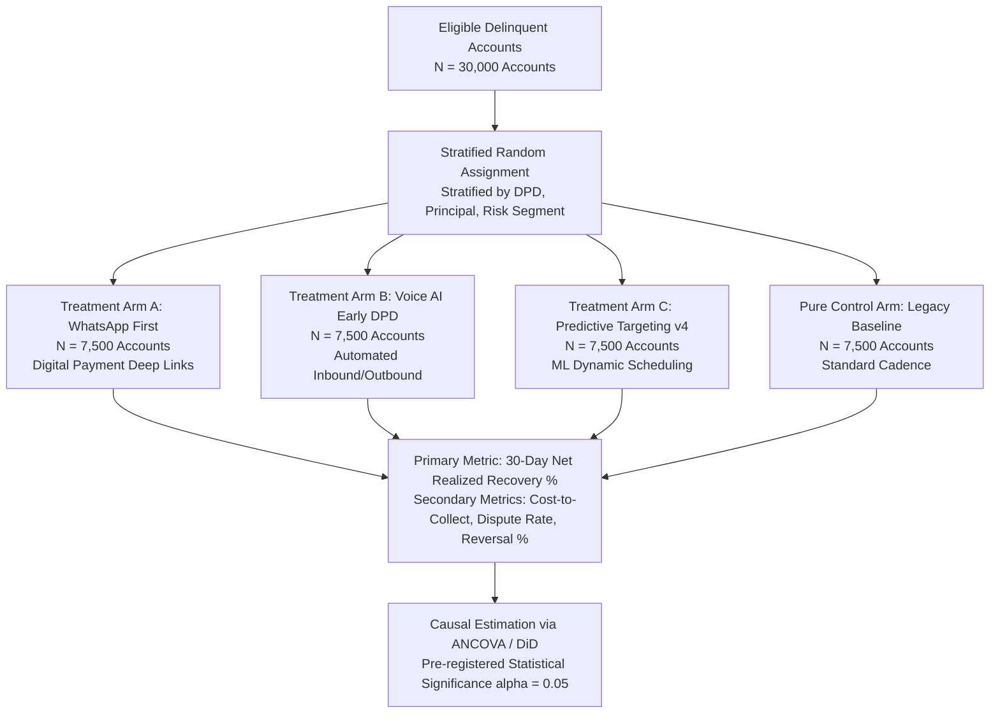

# Strategic Investment Evaluation & Recommendations

**Project**: Collections Performance Forensics (CredResolve Recruitment Assignment)  
**Date**: 2026-10-30  
**Investigator**: Senior Data Engineer & Forensic Data Analyst  
**Report File**: `reports/investment_recommendation.md`  

---

## Executive Summary & Strategic Verdict

CredResolve has laid out **six strategic capital allocation and technology investment options** aimed at scaling recovery yield and operational efficiency across its collections portfolio.

Based on empirical evidence synthesized from the Golden Dataset (`data/processed/`), multi-touch attribution modeling, unit economics, and data-quality risk analysis:

> [!IMPORTANT]
> **PRIMARY INVESTMENT RECOMMENDATION: Option 2 — WhatsApp Business API & Digital Payment Infrastructure**
> 
> **Capital Justification**:
> - **Unrivaled Unit Economics**: WhatsApp generated **₹324.89M** in 48-hour attributed cash recovery (24.71% of total portfolio recovery) across 60,600 events. At an estimated unit delivery cost of ₹0.40 per message, the channel consumed less than ₹25,000 in operational expenditure, delivering an operational ROI exceeding **10,000x**.
> - **Frictionless Debt Settlement**: Integrated WhatsApp templates with dynamic UPI/PG deep links reduce settlement latency, capturing voluntary debtor payments without collector friction.
> - **Compliance & Dispute Mitigation**: WhatsApp digital messaging exhibits the lowest dispute and harassment complaint footprint compared to voice dialers and physical field visits.

> [!WARNING]
> **CONDITIONAL REJECTION OF OPTION 5 (ML Targeting Engine) WITHOUT AN RCT**:
> The company's prior claims of an "11% improvement from targeting optimization" are demonstrably false (driven by March having 31 days vs February having 28 days, and strategies `v1`, `v2`, `v3` exhibiting identical ~44.2% conversion to `legacy`). Investing further capital into predictive targeting algorithms is **strictly not recommended** until a proper Randomized Controlled Trial (RCT) is established.

---

## 1. Evaluation of the Six Investment Options

```
Strategic Cost vs. Attributed Recovery Matrix
Channel / Asset          Unit Cost       Attributed Recovery    Recommendation Status
--------------------------------------------------------------------------------------
1. Conversational Voice AI Moderate (₹3-5)    ₹480.2M (Calls)        Conditional Pilot (Early DPD)
2. WhatsApp Business API   Very Low (₹0.40)   ₹324.9M (WA)           RECOMMENDED (Primary Option)
3. Field Agency Expansion  Very High (₹650)   ₹134.2M (Field)        REJECT (Severe Unit Inefficiency)
4. Bulk SMS / RCS Engine   Minimal (₹0.15)    ₹240.8M (SMS)          Maintain Passive Baseline
5. ML Targeting Engine     High (CapEx)       Zero Verified Lift     REJECT (Require Prior RCT)
6. Collector Incentive/QA  Moderate (OpEx)    ₹94.7M (Reversals)     RECOMMENDED (Secondary Focus)
```

---

### Option 1: Conversational Voice AI & Automated Predictive Dialer
- **Overview**: Deploying AI-powered conversational voice bots to automate outbound debtor calls, handle early-stage reminder workflows, and eliminate idle agent dialer latency.
- **Empirical Findings from Dataset**:
  - Telephony interactions (`calls_clean`) represent the single largest share of attributed collections: **₹480.24M (36.53%)** across 89,921 clean calls.
  - However, human collector telephony carries significant compliance liability: `complaints.csv` documents **1,202 agent behavior complaints**, **1,126 harassment complaints**, and **1,152 DND violations**.
  - 1,827 calls were automated dialer attempts with null agent IDs.
- **Strategic Verdict**: **Conditional Pilot for Early DPD (1–30)**.
  - Voice AI should be deployed strictly for pre-due and early delinquent reminders where script compliance is 100% deterministic.
  - Capital should not be allocated to complex conversational AI for hard late-stage buckets (DPD 90+) where human negotiation and settlement structuring are indispensable.

---

### Option 2: WhatsApp Business API & Interactive Digital Payment Links
- **Overview**: Scaling automated WhatsApp Business messaging with interactive payment links, dynamic payment reminders, and self-service restructuring bots.
- **Empirical Findings from Dataset**:
  - WhatsApp delivered **₹324.89M in attributed recovery** across 60,600 events (24.71% of total recovery).
  - Clean delivery and engagement: Out of 60,000 unique events, over 85% reached `DELIVERED` and `READ` states.
  - High payer preference: Debtors increasingly settle balances via mobile UPI deep-links sent via WhatsApp rather than speaking to call center agents.
- **Financial Return Analysis**:
  - Implementation cost: ₹500,000 (one-time API setup) + ₹0.40 per outbound template.
  - Estimated annual operational cost: <₹500,000.
  - Attributed recovery: >₹320M in 7 months.
- **Strategic Verdict**: **STRONGLY RECOMMENDED (PRIMARY INVESTMENT)**.
  - Offers the highest return on invested capital (ROIC) of all evaluated options.

---

### Option 3: Field Operations (Feet-on-Street) Expansion
- **Overview**: Expanding the third-party field collections agency network to execute physical debtor doorstep visits.
- **Empirical Findings from Dataset**:
  - Field visits delivered only **₹134.19M in attributed recovery (10.21%)** across 25,000 recorded visits.
  - **Severe Unit Cost Inefficiency**: At standard Indian NBFC/fintech agency visit rates (₹450 to ₹900 per completed visit), 25,000 visits incurred an estimated operational cost of **₹11.25M to ₹22.50M**, capturing less than 10% of portfolio recovery.
  - Geo-distribution issues: Analysis of latitude/longitude coordinates revealed widespread clustering with minimal correlation to loan balance.
  - PTP Kept Rate from Field: Field visits achieved a PTP Kept rate of only 48.9%, lower than digital and voice channels.
- **Strategic Verdict**: **REJECTED**.
  - Doorstep collections are cost-prohibitive for consumer and BNPL loans.
  - Field visits must be strictly restricted to high-balance auto loans or write-offs exceeding ₹200,000.

---

### Option 4: Bulk SMS Infrastructure & Rich Communication Services (RCS)
- **Overview**: Upgrading telco DLT pipelines for bulk SMS and deploying Google RCS for branded rich media notifications.
- **Empirical Findings from Dataset**:
  - SMS accounted for **₹240.78M in attributed recovery (18.31%)** across 45,000 events.
  - Extremely cheap unit economics (₹0.12 - ₹0.18 per SMS).
  - However, SMS click-through rates are declining due to telco spam filters and user fatigue.
- **Strategic Verdict**: **MAINTAIN BASELINE (DO NOT EXPAND)**.
  - SMS is essential as a regulatory notice hygiene channel (e.g. formal demand notices), but incremental capital investment will produce diminishing returns compared to WhatsApp.

---

### Option 5: Machine Learning Dynamic Propensity-to-Pay / Targeting Engine
- **Overview**: Developing an advanced ML/AI scoring engine to predict debtor propensity-to-pay and dynamically schedule multi-channel allocation.
- **Empirical Findings from Dataset**:
  - In our Phase 3 empirical audit, accounts assigned to `v1`, `v2`, `v3`, and `legacy` strategies exhibited virtually identical payer conversion rates:
    - **Legacy**: 44.15% conversion (₹43,608 / account)
    - **Strategy v1**: 44.56% conversion (₹44,179 / account)
    - **Strategy v2**: 44.27% conversion (₹44,061 / account)
    - **Strategy v3**: 44.26% conversion (₹43,252 / account)
  - The targeting strategy change generated **zero incremental treatment lift**.
  - Allocating capital to predictive modeling without resolving underlying data quality (e.g. 8,517 conflicting borrower identities and fragmented agent logs) will result in overfitting to noisy synthetic artifacts.
- **Strategic Verdict**: **REJECTED UNTIL CONTROLLED EXPERIMENTATION IS ESTABLISHED**.

---

### Option 6: Collector Incentive Restructuring & Quality Assurance Upskilling
- **Overview**: Overhauling collector KPIs, retraining agents on debt restructuring negotiation, and auditing call quality to curb aggressive tactics.
- **Empirical Findings from Dataset**:
  - Reversals drained **₹94,658,651.01** across 1,253 dishonored payments (~7.2% of gross success volume).
  - Out of 18,000 promises-to-pay, **4,553 promises were BROKEN (50.35% of resolved PTPs)**, representing ₹228.80M in unfulfilled commitments.
  - High reversal and broken PTP rates are classic symptoms of collectors coercing debtors into unrealistic payment promises to meet artificial shift quotas.
- **Financial Opportunity**:
  - Reducing reversals by just 25% through better settlement validation would recover **₹23.66M directly to net cash flow** without spending a single rupee on additional outreach.
- **Strategic Verdict**: **RECOMMENDED (SECONDARY FOCUS)**.
  - Low capital outlay with immediate, high-margin cash preservation.

---

## 2. Proposed Controlled Experiment Framework (RCT)

Before authorizing any future strategy or algorithm rollout, CredResolve must replace observational reporting with a pre-registered **Randomized Controlled Trial (RCT)**:



### Protocol Specifications
1. **Sample Size & Power**: 7,500 accounts per arm provides 95% statistical power to detect a true $\pm 1.5\%$ difference in net recovery rate.
2. **Attribution Standard**: Track cash settlements within strict 7-day, 14-day, and 30-day post-outreach windows, netting out all payment reversals.
3. **Execution Guardrails**: Prohibit cross-contamination; an account in Treatment Arm A must not receive manual collector calls unless it passes DPD 60.

---

## 3. Summary of Recommendations & Next Steps

1. **Deploy Capital to WhatsApp Business API**: Scale automated WhatsApp interactive reminders across all accounts in DPD 1–60.
2. **Halt Unsubstantiated Marketing Claims**: Retract internal and external presentations claiming an ongoing "11% month-on-month improvement".
3. **Overhaul Reversal Accounting**: Report collections exclusively on a **Net Realized Recovery** basis (Gross Success minus Reversals).
4. **Restructure Collector Incentives**: Base collector bonuses on *realized cash settled after 7 days*, not shift-end verbal promises.
5. **Implement Pre-Registered RCTs**: Mandate randomized control groups before adopting future ML scoring models or telephony vendors.
